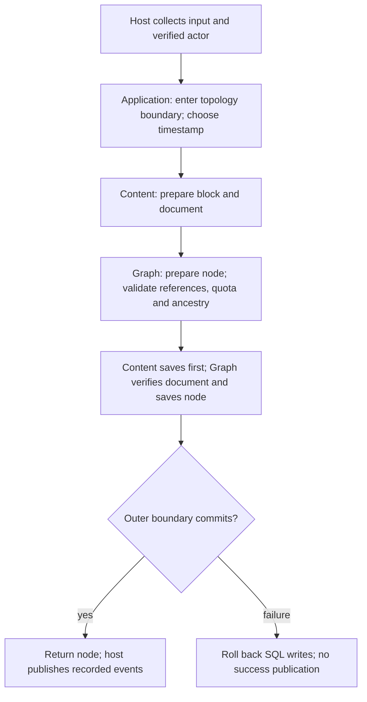

# Reusable workflows and host responsibilities

PTT-131 extracts four concrete Console workflows before the REST host is added. `Atlas.Application` references Graph and Content; it has no reference to Console, EF Core, SQL Server, Identity infrastructure or a web framework. Graph and Content remain independent of each other's concrete types.

## Ownership inventory

| Existing responsibility | Owner after this slice | What the host supplies |
|---|---|---|
| Construct node; validate author/type/parent references, requested types, quota and ancestry | [Graph NodeCreationService](../../src/Atlas.Graph/Nodes/NodeCreationService.cs) | Node repository with reference lookup and topology/operation capabilities |
| Construct a Markdown block and document | [Content DocumentService](../../src/Atlas.Content/Documents/DocumentService.cs) | Document repository and operation timestamp |
| Create node plus description atomically | [Application NodeCreationService](../../src/Atlas.Application/NodeCreationService.cs) | Both repositories using the same transactional store |
| Add/update/move/remove description blocks | Content DocumentService; [BlockInput](../../src/Atlas.Content/Blocks/BlockInput.cs) describes typed input | Parsed input; Content owns construction, validation, mutation and saving |
| Authorize editing a node's description | [Application NodeDescriptionService](../../src/Atlas.Application/NodeDescriptionService.cs) | Verified actor ID; coordinator reloads node and checks author on every mutation |
| Create custom node type | [Graph NodeTypeCreationService](../../src/Atlas.Graph/Nodes/NodeTypes/NodeTypeCreationService.cs) | Type repository; SQL uniqueness remains authoritative under races |
| Check proposed parent ancestry | Existing Graph NodeRelationshipService / GraphRelationshipValidation | Console invokes Attach; its duplicated WouldCreateCycle traversal is removed |
| Input, menus, display and error messages | Console command/display classes, ConsoleUi, DescriptionBlockCommands | Console streams and navigation state |
| Dependency composition, configuration, console login/session, local telemetry lifetime | Console Program, Identity and Observability adapters | Host-specific setup; API supplies its own request/session lifetime |
| SQL mapping, reference lookups, atomicity and coordination locks | Infrastructure adapters, currently under Console/Storage plus Atlas.Persistence | Repository/context factories; future relocation must preserve shared transactions |
| Voting eligibility, comment target/moderator checks, Content node-lifecycle observer | Existing host-composed cross-boundary adapters | Classify as reusable integration adapters when preparing API composition; do not move automatically into a domain |
| Event dispatch and subscriber registration | Existing Console event publisher/composition | Publish returned node events after creation returns; not inside the business transaction |
| Other menus for votes/reactions/comments/communities/participants/moderation/notifications | Existing Console command adapters calling domain services/aggregates | Further extraction is driven by an actual reusable use case, not blanket relocation |

This is a workflow extraction, not a claim that all Console orchestration or infrastructure has moved. In particular, the API must not reference Console merely to reuse its SQL adapters or event bus. Those composition dependencies remain visible preparation work. No migrations or EF mappings change in this slice.

## Node creation flow

Both proposals are prepared before writes. Graph receives only a description ID; it does not construct Content objects. After Content saves, Graph checks that the description exists before saving the node. Block, document and node share one UTC timestamp.

The topology boundary is still provided by the node repository. Real SQL repositories join the same ambient SqlOperationBoundary; nested Content saves cannot commit the outer operation early. Repositories repeat their own validation and quota checks. Passing repositories for different databases is rejected by the existing SQL coordination checks. Lightweight adapters without a transaction capability do not acquire rollback guarantees simply by using this coordinator.

Returning means the coordinator's boundary has completed. Existing callers must continue to publish Node.DomainEvents afterward and clear them only after dispatch. This extraction does not introduce a durable domain-event bus or universal retry semantics. Audit outbox delivery remains a separate mechanism.

## Description editing and trust

Console now collects BlockInput records and delegates mutations to NodeDescriptionService. That coordinator checks participant availability, reloads the node, enforces its author rule, and invokes Content inside the shared operation boundary. Authorization therefore does not depend on opening the Console menu first. The host must establish the actor identity; an arbitrary supplied Guid is not authentication.

Content loads the current document for every operation. Updating a block requires membership in that document and an input matching the stored kind. Existing block IDs, validation and timestamp rules remain unchanged. Removing a block detaches it from the document and retains its payload. Poll editing remains unsupported, and poll/chart placeholder IDs retain their existing meaning: they do not create real polls or charts.

These are internal application contracts, not HTTP DTOs. The API will map requests/results and verified identity into them; endpoint authorization, safe error responses and transport controls still belong to the API host.

## Focused negative-path evidence

| Expectation | Evidence |
|---|---|
| Invalid node title or unavailable parent/type does not write Content | Application WorkflowTests |
| A failed final node save rolls back earlier Content writes | Application supplied-boundary test; existing SqlOperationValidationTests with real SQL adapters |
| Another participant cannot edit a description; unavailable actor is rejected | Application WorkflowTests; SQL application workflow test |
| Failed document save during add does not leave an orphan block | SqlApplicationWorkflowTests with injected document-save failure |
| Invalid position/payload, wrong block kind or unrelated block does not change composition/payload | Application WorkflowTests; existing ContentValidationTests |
| Reorder/remove/update preserve identity and retained payload semantics | Application WorkflowTests and SqlApplicationWorkflowTests |
| Duplicate type name is rejected case-insensitively | Application WorkflowTests; existing SQL constraints remain unchanged |
| Existing graph rules prevent cycles | Existing Graph/SQL relationship validation tests; Console delegates to the existing Graph service |

[Application tests](../../tests/Atlas.Application.Tests/WorkflowTests.cs) reference only Atlas.Application. [SQL workflow tests](../../tests/Atlas.Persistence.Tests/SqlApplicationWorkflowTests.cs), [SQL operation tests](../../tests/Atlas.Persistence.Tests/SqlOperationValidationTests.cs) and [quota tests](../../tests/Atlas.Persistence.Tests/SqlNodeCreationQuotaTests.cs) exercise host-supplied persistence. SQL tests need ATLAS_SQL_TEST_CONNECTION_STRING; skipped tests are not evidence that SQL behavior passed locally.

This addresses the negative paths affected by PTT-131, not the complete cross-domain inventory required by PTT-123. PTT-124 rate-limiting responsibility review and PTT-125 HTTP/browser security remain separate follow-ups; existing node quota enforcement is preserved.
