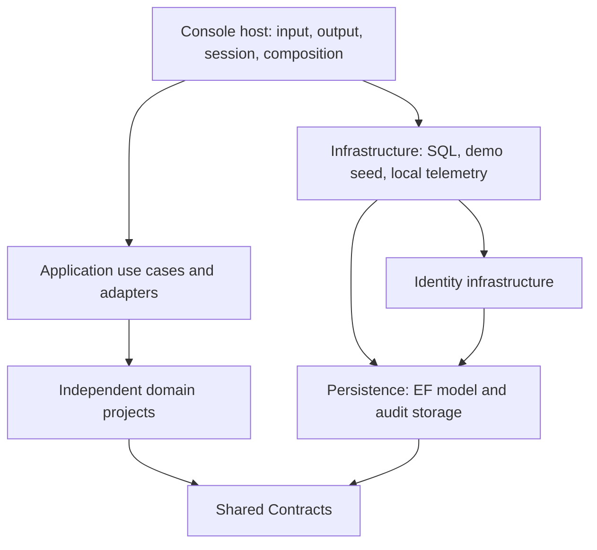
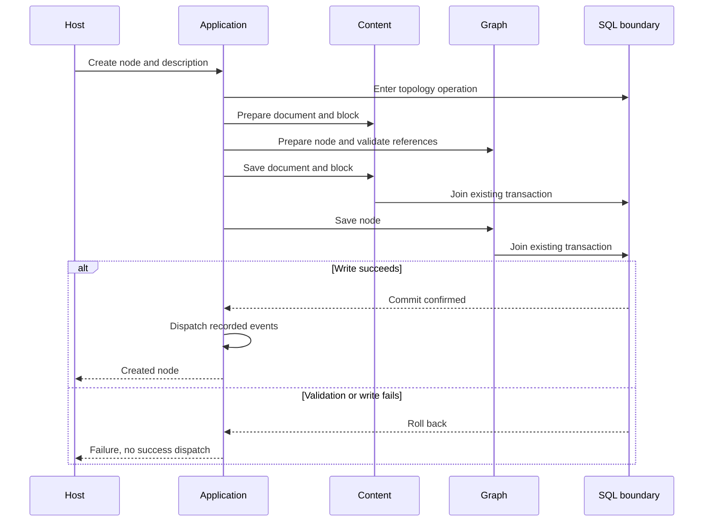

# Thin Console host and reusable application core

PTT-131 now separates terminal presentation from reusable use cases and infrastructure. A future API composes the same Application and Infrastructure projects without referencing the Console executable.

Follow the [visual architecture guide](diagrams/README.md) for linked UML views, workflow decision trees, transaction lifetimes and failure branches, with drill-down links to source and tests.

## What belongs where

| Project | Responsibility | Examples |
|---|---|---|
| Atlas.Console | Menus, keyboard input, terminal rendering, console session lifetime, startup composition | ConsoleApplication, NodeCommands, DescriptionBlockCommands, ConsoleIdentitySession, Diagnostics |
| Atlas.Application | Cross-domain use cases, eligibility adapters, recipient selection, event dispatch and reusable queries | NodeWorkflowService, NodeCreationService, NodeDescriptionService, CommentWorkflowService, ModerationWorkflowService, ReactionVotingService, CurrentUserNotifications, AncestorNavigation |
| Domain projects | Business rules and boundary-owned operations | Graph node/type services, Content DocumentService and BlockInput, CommunityService, Comments/Voting/Moderation/Notifications operations |
| Atlas.Infrastructure | Concrete SQL repositories, transaction/reference adapters, SQL/demo startup and local telemetry lifecycle | Storage/Sql*Repository, SqlOperationBoundary, SqlStorage, SeedData, LocalDevelopmentTelemetry |
| Atlas.Persistence | Existing EF context, rows, mappings, migrations, SQL discovery queries and audit outbox delivery | AtlasDataContext; unchanged schema/migrations |
| Atlas.Identity | ASP.NET Identity account infrastructure, policies and current-profile query | AtlasAccounts, IdentityServices, SessionParticipantQuery |
| Atlas.Contracts | Shared IDs/events/operation/identity ports and telemetry envelope | IAuthenticatedActor, IEventPublisher, IOperationBoundary, Telemetry |

Application has no reference to Console, Infrastructure, Persistence, Identity, EF or a terminal API. Infrastructure has no reference to Console. Graph and Content remain independent of each other's concrete types. Identity's caller abstraction moved to Contracts so consuming an authenticated actor does not pull account/SQL infrastructure into the application core.

## What opening Console should feel like

The Storage, SeedData, Eventing, Content-subscriber, Voting-adapter and Notifications-workflow directories have moved out. The remaining files describe terminal screens, navigation, input parsing, rendering and session handling. Console no longer calls repository Save/SaveMetadata or constructs notification requests. It calls domain/application services, then displays their results.

Program remains the composition root: it selects SQL, configures Identity, creates the local-development telemetry adapter, wires subscriptions and injects the console session. That is host work. ConsoleIdentitySession retains the principal/security stamp and interactive login behavior; SessionParticipantQuery performs its actual EF profile read outside the host. Developer SQL screens format materialized rows, while infrastructure performs the queries. Repository reads used only to render screens and presentation records such as NodeVoteSummary remain in the host; they do not own mutation rules or transaction sequencing.

Console is not intended to become a five-line program: menus and terminal rendering remain substantial. The boundary is responsibility, not file length.

## Reusable workflows

| Use case | Reusable implementation | Host responsibility |
|---|---|---|
| Create node plus Markdown description | Application NodeCreationService coordinates Graph/Content preparation and saves; NodeWorkflowService dispatches events afterward | Collect text/type/parent selections; show allowance and result |
| Rename/archive/restore/attach/detach node | NodeWorkflowService delegates domain rules and persistence, then dispatches recorded events | Parse selection and display outcome |
| Add/update/move/remove description blocks | NodeDescriptionService checks active actor and author; Content DocumentService owns block construction, membership and saving | Build typed BlockInput from prompts |
| Custom node types and built-in catalog | Graph NodeTypeCreationService and SystemNodeTypeCatalog | Prompt for custom input; invoke built-in catalog at startup |
| Community description/lifecycle/disassociation | CommunityService owns mutation and saving | Prompt/confirm action; domain retains ownership checks |
| Apply a reaction and cast its vote | ReactionVotingService coordinates both writes in one operation boundary and builds reaction summaries | Choose reaction and vote value |
| Create/reply to comments | CommentWorkflowService invokes Comments, then selects node-author/parent-author notification recipients | Collect text and render thread |
| Moderation decision/restoration/review request | ModerationWorkflowService obtains edit timestamps and creates recipient-specific notifications after domain operation | Collect decision/rationale/public reason |
| Notifications for current participant | CurrentUserNotifications consumes IAuthenticatedActor from Contracts | Display pages and preference inputs |
| Voting/comment target eligibility, moderator decisions and Content event observation | Application integration adapters implement the consumer domain's port | Supply repositories/services and optional terminal diagnostic callbacks |
| Bounded parent-route reads | Application AncestorNavigation | Choose route and render breadcrumbs |

Other commands such as profile editing and ordinary voting already call domain services. They stay terminal adapters; no duplicate application wrapper is needed just to forward a single domain call.

## Transactions, events and trust

NodeCreationService prepares the Content and Graph proposals before any write, using one operation timestamp. Content saves the block/document first; Graph verifies the description exists and saves the node. SqlOperationBoundary remains the same shared transaction implementation, relocated to Infrastructure. Nested repositories join it; different-database factories are rejected. Custom in-memory adapters require their own transaction capability for rollback guarantees.

NodeWorkflowService publishes recorded Graph events only after the outer creation/mutation boundary returns successfully and clears them after successful dispatch. Comment/moderation notifications also follow their domain save. Subscriber failure does not undo a committed business operation; in-memory dispatch is synchronous and non-durable. This is separate from the durable security-audit outbox. The generic publisher and Content subscriber use optional structured diagnostic notices; Console owns their terminal formatting.

Reaction application plus voting now share one operation boundary, so a rejected vote does not leave a newly applied reaction behind. Existing domain authorization, reference checks, quota enforcement and repository validation remain in force. Node operations check current persisted authorship; description edits reload the node and check ownership per mutation. Hosts establish identity; an arbitrary actor Guid is not authentication. API controllers must map request DTOs and verified identity into these operations rather than accept domain objects from callers.

All existing provisional poll/chart behavior is preserved. No real poll/chart domain, durable domain-event transport, new limiter or API endpoint is introduced.

## Verification and future API composition

- Application tests reference Application only and verify host/infrastructure independence, domain independence, event ordering/failure semantics and focused workflow negative paths.
- Persistence tests now reference Infrastructure rather than Console. They verify that infrastructure has no Console/terminal dependency and exercise real SQL repositories and workflows in CI.
- The SQL Console creation regression moved to Console.Tests, where its terminal interaction belongs.
- SQL workflow tests cover description authorization/rollback, reaction-plus-vote rollback, comment recipient selection and moderation notifications.
- Existing domain, quota, reference, discovery, audit and transaction tests remain in their suites.

For the API, reference Application, Infrastructure and Identity from the new composition root; configure repositories/context factories, event subscriptions, telemetry and the request-scoped IAuthenticatedActor. Keep HTTP models, authentication middleware, endpoint policies, rate limiting, browser controls and error/status mapping in that host. LocalDevelopmentTelemetry remains a separate development-only file adapter; production wiring belongs in a different adapter/file.

This finishes the thin-host separation for current implemented workflows. PTT-123 still owns the broader cross-domain negative-path inventory; PTT-124/PTT-125 own rate-limiting and HTTP/browser responsibility review. No EF schema or migration changes are required.
