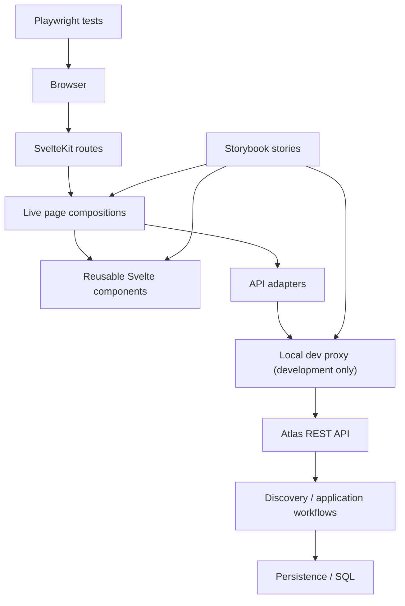
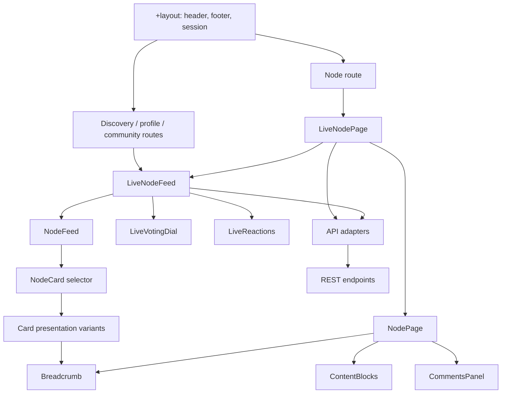
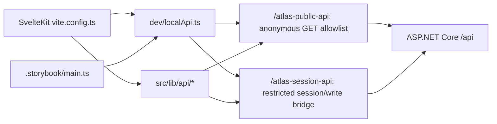
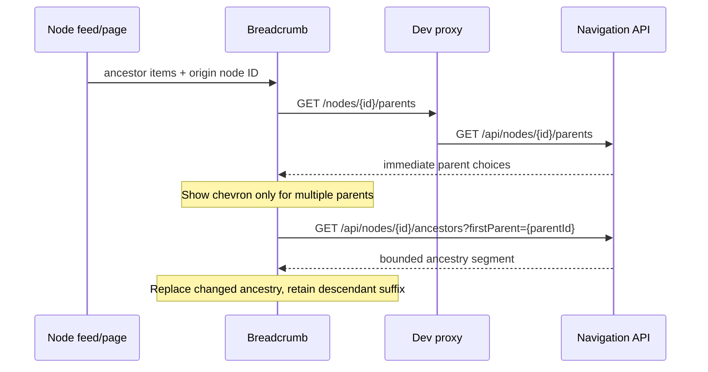
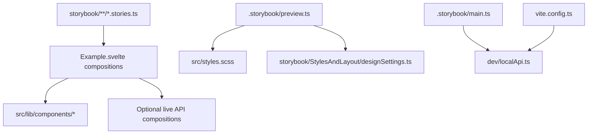

# Atlas Web: frontend architecture and PR #360 review guide

> Scope: PR [#360](https://github.com/williamowen65/atlas-the-public-think-tank/pull/360), branch `ptt-146-shell-and-feed`. This is a **review map**, not a claim that the PR is production-ready. Paths link to the working branch and may change during review.

## 1. System context

The frontend is a SvelteKit application built from Svelte 5 components. Storybook is a **separate development and review host** that imports production components; the production app must not depend on Storybook files. The local development proxy is shared tooling, not runtime application code.



**Source references:** [application shell](https://github.com/williamowen65/atlas-the-public-think-tank/blob/ptt-146-shell-and-feed/src/hosts/Atlas.Web/src/routes/+layout.svelte) · [Discovery route](https://github.com/williamowen65/atlas-the-public-think-tank/blob/ptt-146-shell-and-feed/src/hosts/Atlas.Web/src/routes/+page.svelte) · [live node composition](https://github.com/williamowen65/atlas-the-public-think-tank/blob/ptt-146-shell-and-feed/src/hosts/Atlas.Web/src/lib/components/LiveNodePage.svelte) · [Discovery adapter](https://github.com/williamowen65/atlas-the-public-think-tank/blob/ptt-146-shell-and-feed/src/hosts/Atlas.Web/src/lib/api/discovery.ts) · [shared local proxy](https://github.com/williamowen65/atlas-the-public-think-tank/blob/ptt-146-shell-and-feed/src/hosts/Atlas.Web/dev/localApi.ts) · [nodes API](https://github.com/williamowen65/atlas-the-public-think-tank/blob/ptt-146-shell-and-feed/src/hosts/Atlas.Api/Controllers/NodesController.cs) · [navigation API](https://github.com/williamowen65/atlas-the-public-think-tank/blob/ptt-146-shell-and-feed/src/hosts/Atlas.Api/Controllers/NavigationController.cs) · [Storybook configuration](https://github.com/williamowen65/atlas-the-public-think-tank/blob/ptt-146-shell-and-feed/src/hosts/Atlas.Web/.storybook/main.ts).

## 2. Frontend component wiring



**Source references:** [NodeFeed](https://github.com/williamowen65/atlas-the-public-think-tank/blob/ptt-146-shell-and-feed/src/hosts/Atlas.Web/src/lib/components/NodeFeed.svelte) · [NodeCard presentation selector](https://github.com/williamowen65/atlas-the-public-think-tank/blob/ptt-146-shell-and-feed/src/hosts/Atlas.Web/src/lib/components/NodeCard.svelte) · [shared card contract](https://github.com/williamowen65/atlas-the-public-think-tank/blob/ptt-146-shell-and-feed/src/hosts/Atlas.Web/src/lib/components/node-card-versions/types.ts) · [default card presentation](https://github.com/williamowen65/atlas-the-public-think-tank/blob/ptt-146-shell-and-feed/src/hosts/Atlas.Web/src/lib/components/node-card-versions/NodeCardRibbonCorner.svelte) · [shared breadcrumb](https://github.com/williamowen65/atlas-the-public-think-tank/blob/ptt-146-shell-and-feed/src/hosts/Atlas.Web/src/lib/components/Breadcrumb.svelte) · [NodePage](https://github.com/williamowen65/atlas-the-public-think-tank/blob/ptt-146-shell-and-feed/src/hosts/Atlas.Web/src/lib/components/NodePage.svelte) · [content blocks](https://github.com/williamowen65/atlas-the-public-think-tank/blob/ptt-146-shell-and-feed/src/hosts/Atlas.Web/src/lib/components/ContentBlocks.svelte) · [comments](https://github.com/williamowen65/atlas-the-public-think-tank/blob/ptt-146-shell-and-feed/src/hosts/Atlas.Web/src/lib/components/CommentsPanel.svelte) · [voting](https://github.com/williamowen65/atlas-the-public-think-tank/blob/ptt-146-shell-and-feed/src/hosts/Atlas.Web/src/lib/components/LiveVotingDial.svelte) · [reactions](https://github.com/williamowen65/atlas-the-public-think-tank/blob/ptt-146-shell-and-feed/src/hosts/Atlas.Web/src/lib/components/LiveReactions.svelte).

The `Live*` components integrate data fetching and user actions. Their presentation counterparts accept props and callbacks, allowing Storybook to render them with controlled examples. The `NodeCard` selector routes to presentation variants. Shared behavior should be implemented in shared components, not copied into individual pages.

## 3. Routing and page entry points

| User-facing area | Route | Composition |
| --- | --- | --- |
| Discovery | [Home](https://github.com/williamowen65/atlas-the-public-think-tank/blob/ptt-146-shell-and-feed/src/hosts/Atlas.Web/src/routes/+page.svelte) | [LiveNodeFeed](https://github.com/williamowen65/atlas-the-public-think-tank/blob/ptt-146-shell-and-feed/src/hosts/Atlas.Web/src/lib/components/LiveNodeFeed.svelte) |
| Node and child discussions | [Nodes](https://github.com/williamowen65/atlas-the-public-think-tank/blob/ptt-146-shell-and-feed/src/hosts/Atlas.Web/src/routes/nodes/+page.svelte) | [LiveNodePage](https://github.com/williamowen65/atlas-the-public-think-tank/blob/ptt-146-shell-and-feed/src/hosts/Atlas.Web/src/lib/components/LiveNodePage.svelte) and child feeds |
| Communities | [Communities](https://github.com/williamowen65/atlas-the-public-think-tank/blob/ptt-146-shell-and-feed/src/hosts/Atlas.Web/src/routes/communities/+page.svelte) · [Community detail](https://github.com/williamowen65/atlas-the-public-think-tank/blob/ptt-146-shell-and-feed/src/hosts/Atlas.Web/src/routes/communities/[id]/+page.svelte) | [Node feeds](https://github.com/williamowen65/atlas-the-public-think-tank/blob/ptt-146-shell-and-feed/src/hosts/Atlas.Web/src/lib/components/LiveNodeFeed.svelte) |
| Profiles | [Profiles](https://github.com/williamowen65/atlas-the-public-think-tank/blob/ptt-146-shell-and-feed/src/hosts/Atlas.Web/src/routes/profiles/+page.svelte) | [LiveProfilePage](https://github.com/williamowen65/atlas-the-public-think-tank/blob/ptt-146-shell-and-feed/src/hosts/Atlas.Web/src/lib/components/LiveProfilePage.svelte) |
| Create / account | [Create](https://github.com/williamowen65/atlas-the-public-think-tank/blob/ptt-146-shell-and-feed/src/hosts/Atlas.Web/src/routes/new/+page.svelte) · [Login](https://github.com/williamowen65/atlas-the-public-think-tank/blob/ptt-146-shell-and-feed/src/hosts/Atlas.Web/src/routes/login/+page.svelte) · [Register](https://github.com/williamowen65/atlas-the-public-think-tank/blob/ptt-146-shell-and-feed/src/hosts/Atlas.Web/src/routes/register/+page.svelte) | [LiveNodeForm](https://github.com/williamowen65/atlas-the-public-think-tank/blob/ptt-146-shell-and-feed/src/hosts/Atlas.Web/src/lib/components/LiveNodeForm.svelte) · [SessionControl](https://github.com/williamowen65/atlas-the-public-think-tank/blob/ptt-146-shell-and-feed/src/hosts/Atlas.Web/src/lib/components/SessionControl.svelte) |

## 4. API and local development boundaries



**Source references:** [app Vite config](https://github.com/williamowen65/atlas-the-public-think-tank/blob/ptt-146-shell-and-feed/src/hosts/Atlas.Web/vite.config.ts) · [Storybook Vite config](https://github.com/williamowen65/atlas-the-public-think-tank/blob/ptt-146-shell-and-feed/src/hosts/Atlas.Web/.storybook/main.ts) · [proxy and allowlists](https://github.com/williamowen65/atlas-the-public-think-tank/blob/ptt-146-shell-and-feed/src/hosts/Atlas.Web/dev/localApi.ts) · [session/comment client](https://github.com/williamowen65/atlas-the-public-think-tank/blob/ptt-146-shell-and-feed/src/hosts/Atlas.Web/src/lib/api/comments.ts) · [communities client](https://github.com/williamowen65/atlas-the-public-think-tank/blob/ptt-146-shell-and-feed/src/hosts/Atlas.Web/src/lib/api/communities.ts) · [Discovery client](https://github.com/williamowen65/atlas-the-public-think-tank/blob/ptt-146-shell-and-feed/src/hosts/Atlas.Web/src/lib/api/discovery.ts) · [node page client](https://github.com/williamowen65/atlas-the-public-think-tank/blob/ptt-146-shell-and-feed/src/hosts/Atlas.Web/src/lib/api/nodePage.ts) · [draft client](https://github.com/williamowen65/atlas-the-public-think-tank/blob/ptt-146-shell-and-feed/src/hosts/Atlas.Web/src/lib/api/privateDrafts.ts).

The `dev/` proxy exists only for local development and Storybook; it is **not** the deployment security boundary. Review anonymous read permissions separately from authenticated writes, cookie forwarding, CSRF, and production API configuration. Ensure no application source imports `.storybook/` or `storybook/`.

## 5. Multi-parent breadcrumb flow



**Source references:** [breadcrumb dropdown and lazy fetching](https://github.com/williamowen65/atlas-the-public-think-tank/blob/ptt-146-shell-and-feed/src/hosts/Atlas.Web/src/lib/components/Breadcrumb.svelte) · [parent and ancestor endpoints](https://github.com/williamowen65/atlas-the-public-think-tank/blob/ptt-146-shell-and-feed/src/hosts/Atlas.Api/Controllers/NavigationController.cs) · [initial bounded breadcrumb reader](https://github.com/williamowen65/atlas-the-public-think-tank/blob/ptt-146-shell-and-feed/src/Atlas.Persistence/Discovery/DiscoveryBreadcrumbReader.cs) · [Discovery breadcrumb mapping](https://github.com/williamowen65/atlas-the-public-think-tank/blob/ptt-146-shell-and-feed/src/hosts/Atlas.Web/src/lib/api/discovery.ts).

**Review warning:** Verify the selected parent is preserved after rerender, that the menu appears on the correct segment (including an ancestor farther back), and that the 3-ancestor pagination and horizontal scroll behave correctly. Also verify the initial Discovery response's branch metadata and the lazy endpoint agree. A working Storybook scenario does not establish that the live API integration works.

## 6. Storybook: what it owns and what it does not

Storybook owns **stories, fixtures, design experiments, and preview configuration**. It does not own application routes, reusable components, API adapters, or shared dev infrastructure.



**Source references:** [preview globals](https://github.com/williamowen65/atlas-the-public-think-tank/blob/ptt-146-shell-and-feed/src/hosts/Atlas.Web/.storybook/preview.ts) · [design controls](https://github.com/williamowen65/atlas-the-public-think-tank/blob/ptt-146-shell-and-feed/src/hosts/Atlas.Web/storybook/StylesAndLayout/designSettings.ts) · [breadcrumb story registration](https://github.com/williamowen65/atlas-the-public-think-tank/blob/ptt-146-shell-and-feed/src/hosts/Atlas.Web/storybook/Breadcrumb/Breadcrumb.stories.ts) · [multi-parent prototype](https://github.com/williamowen65/atlas-the-public-think-tank/blob/ptt-146-shell-and-feed/src/hosts/Atlas.Web/storybook/Breadcrumb/MultipleParentsExample.svelte) · [node page stories](https://github.com/williamowen65/atlas-the-public-think-tank/blob/ptt-146-shell-and-feed/src/hosts/Atlas.Web/storybook/NodePage/NodePage.stories.ts) · [feed stories](https://github.com/williamowen65/atlas-the-public-think-tank/blob/ptt-146-shell-and-feed/src/hosts/Atlas.Web/storybook/Feed/Feed.stories.ts) · [live preview](https://github.com/williamowen65/atlas-the-public-think-tank/blob/ptt-146-shell-and-feed/src/hosts/Atlas.Web/storybook/NodeCard/LiveNodePreview.svelte).

## 7. Guided PR review order

Review in **dependency and user-flow order**, not GitHub's alphabetical order. For each section: read the entry point, trace its imports and callbacks, inspect the API contract, then examine tests. Mark findings as **fix before merge**, **follow-up**, or **style/documentation standard**.

| Pass | Focus | Start here | Review questions |
| --- | --- | --- | --- |
| 1 | Build, configuration, dependency direction | [scripts/dependencies](https://github.com/williamowen65/atlas-the-public-think-tank/blob/ptt-146-shell-and-feed/src/hosts/Atlas.Web/package.json), [Vite](https://github.com/williamowen65/atlas-the-public-think-tank/blob/ptt-146-shell-and-feed/src/hosts/Atlas.Web/vite.config.ts), [dev proxy](https://github.com/williamowen65/atlas-the-public-think-tank/blob/ptt-146-shell-and-feed/src/hosts/Atlas.Web/dev/localApi.ts), [Storybook](https://github.com/williamowen65/atlas-the-public-think-tank/blob/ptt-146-shell-and-feed/src/hosts/Atlas.Web/.storybook/main.ts) | Does the SPA depend on Storybook? Are dev-only permissions bounded? |
| 2 | Design system and shell | [styles](https://github.com/williamowen65/atlas-the-public-think-tank/blob/ptt-146-shell-and-feed/src/hosts/Atlas.Web/src/styles.scss), [layout](https://github.com/williamowen65/atlas-the-public-think-tank/blob/ptt-146-shell-and-feed/src/hosts/Atlas.Web/src/routes/+layout.svelte), [header](https://github.com/williamowen65/atlas-the-public-think-tank/blob/ptt-146-shell-and-feed/src/hosts/Atlas.Web/src/lib/components/AtlasHeader.svelte) | Consistent tokens, naming, responsive behavior, accessibility? |
| 3 | Route navigation | [Discovery](https://github.com/williamowen65/atlas-the-public-think-tank/blob/ptt-146-shell-and-feed/src/hosts/Atlas.Web/src/routes/+page.svelte), [nodes](https://github.com/williamowen65/atlas-the-public-think-tank/blob/ptt-146-shell-and-feed/src/hosts/Atlas.Web/src/routes/nodes/+page.svelte), [community](https://github.com/williamowen65/atlas-the-public-think-tank/blob/ptt-146-shell-and-feed/src/hosts/Atlas.Web/src/routes/communities/[id]/+page.svelte) | URLs, state, reload/back navigation, loading/error states? |
| 4 | Read models and adapters | [Discovery API](https://github.com/williamowen65/atlas-the-public-think-tank/blob/ptt-146-shell-and-feed/src/hosts/Atlas.Web/src/lib/api/discovery.ts), [node API](https://github.com/williamowen65/atlas-the-public-think-tank/blob/ptt-146-shell-and-feed/src/hosts/Atlas.Web/src/lib/api/nodePage.ts), [card projection](https://github.com/williamowen65/atlas-the-public-think-tank/blob/ptt-146-shell-and-feed/src/Atlas.Discovery/DiscoveryCard.cs), [query](https://github.com/williamowen65/atlas-the-public-think-tank/blob/ptt-146-shell-and-feed/src/Atlas.Persistence/Discovery/DiscoveryEfQuery.cs) | Stable DTOs, nulls, moderation, paging, no duplicated business rules? |
| 5 | Feeds and cards | [live feed](https://github.com/williamowen65/atlas-the-public-think-tank/blob/ptt-146-shell-and-feed/src/hosts/Atlas.Web/src/lib/components/LiveNodeFeed.svelte), [feed](https://github.com/williamowen65/atlas-the-public-think-tank/blob/ptt-146-shell-and-feed/src/hosts/Atlas.Web/src/lib/components/NodeFeed.svelte), [selector](https://github.com/williamowen65/atlas-the-public-think-tank/blob/ptt-146-shell-and-feed/src/hosts/Atlas.Web/src/lib/components/NodeCard.svelte), [contract](https://github.com/williamowen65/atlas-the-public-think-tank/blob/ptt-146-shell-and-feed/src/hosts/Atlas.Web/src/lib/components/node-card-versions/types.ts) | Same behavior in every presentation and feed context? |
| 6 | Breadcrumb and graph navigation | [breadcrumb](https://github.com/williamowen65/atlas-the-public-think-tank/blob/ptt-146-shell-and-feed/src/hosts/Atlas.Web/src/lib/components/Breadcrumb.svelte), [navigation API](https://github.com/williamowen65/atlas-the-public-think-tank/blob/ptt-146-shell-and-feed/src/hosts/Atlas.Api/Controllers/NavigationController.cs) | Correct multi-parent switching, pagination, cycles, scroll anchoring, hidden nodes? |
| 7 | Node page and content | [live page](https://github.com/williamowen65/atlas-the-public-think-tank/blob/ptt-146-shell-and-feed/src/hosts/Atlas.Web/src/lib/components/LiveNodePage.svelte), [page](https://github.com/williamowen65/atlas-the-public-think-tank/blob/ptt-146-shell-and-feed/src/hosts/Atlas.Web/src/lib/components/NodePage.svelte), [blocks](https://github.com/williamowen65/atlas-the-public-think-tank/blob/ptt-146-shell-and-feed/src/hosts/Atlas.Web/src/lib/components/ContentBlocks.svelte) | Tabs, content, child feeds, keyboard use, empty states? |
| 8 | Writes, identity, community | [form](https://github.com/williamowen65/atlas-the-public-think-tank/blob/ptt-146-shell-and-feed/src/hosts/Atlas.Web/src/lib/components/LiveNodeForm.svelte), [votes](https://github.com/williamowen65/atlas-the-public-think-tank/blob/ptt-146-shell-and-feed/src/hosts/Atlas.Web/src/lib/components/LiveVotingDial.svelte), [comments](https://github.com/williamowen65/atlas-the-public-think-tank/blob/ptt-146-shell-and-feed/src/hosts/Atlas.Web/src/lib/components/CommentsPanel.svelte), [profile](https://github.com/williamowen65/atlas-the-public-think-tank/blob/ptt-146-shell-and-feed/src/hosts/Atlas.Web/src/lib/components/LiveMyProfile.svelte) | Auth prompts, failed writes, CSRF, optimistic updates, validation? |
| 9 | Storybook parity | [preview](https://github.com/williamowen65/atlas-the-public-think-tank/blob/ptt-146-shell-and-feed/src/hosts/Atlas.Web/.storybook/preview.ts), [style story](https://github.com/williamowen65/atlas-the-public-think-tank/blob/ptt-146-shell-and-feed/src/hosts/Atlas.Web/storybook/StylesAndLayout/StylesAndLayout.stories.ts), [branch example](https://github.com/williamowen65/atlas-the-public-think-tank/blob/ptt-146-shell-and-feed/src/hosts/Atlas.Web/storybook/Breadcrumb/MultipleParentsExample.svelte) | Stories represent real component contracts; no hidden app dependency? |
| 10 | Tests, seed, readiness | [feed tests](https://github.com/williamowen65/atlas-the-public-think-tank/blob/ptt-146-shell-and-feed/src/hosts/Atlas.Web/tests/feed.spec.ts), [page tests](https://github.com/williamowen65/atlas-the-public-think-tank/blob/ptt-146-shell-and-feed/src/hosts/Atlas.Web/tests/node-page.spec.ts), [vote tests](https://github.com/williamowen65/atlas-the-public-think-tank/blob/ptt-146-shell-and-feed/src/hosts/Atlas.Web/tests/voting.spec.ts), [seed](https://github.com/williamowen65/atlas-the-public-think-tank/blob/ptt-146-shell-and-feed/src/Atlas.Application/Storage/SeedData/SeedPublicThinkTank.cs), [seed instructions](https://github.com/williamowen65/atlas-the-public-think-tank/blob/ptt-146-shell-and-feed/docs/workflows/local-demo-seed.md) | Build/check/Playwright/API tests pass? Reproducible demos? |

The full changed-file list remains authoritative in [PR #360 Files changed](https://github.com/williamowen65/atlas-the-public-think-tank/pull/360/files). This guide groups related files, not every individual changed file. Review other touched files in the same dependency group.

## 8. Review standards to establish

- **Formatting:** consistent import grouping, component prop layout, indentation, line length, and SCSS organization; avoid dense one-line markup that hides behavior.
- **Boundaries:** presentation components take props/callbacks; live compositions own network state; API adapters own request/response validation; server owns authorization and calculations.
- **Documentation:** document intent and non-obvious lifecycle/scroll logic; link to implementation and relevant tests; avoid comments that merely repeat code.
- **Accessibility:** keyboard interaction, focus restoration, menu semantics, reduced-motion considerations, responsive overflow, and screen-reader labels.
- **Failure behavior:** loading/error/empty/anonymous states, aborted requests, retries, stale responses, and failed voting reset.
- **Tests:** cover branching at different depths, switching back, all card contexts, and the proxy allowlist. Avoid claiming end-to-end coverage from static stories.
- **Merge gate:** complete build, typecheck, relevant .NET tests, Playwright tests, accessibility checks, manual SPA/Storybook walkthrough, and documented follow-ups.

## 9. Local review commands

From `src/hosts/Atlas.Web`:

```bash
npm run check
npm run build
npm run storybook
npm run test
```

For Storybook with the local REST API, use `npm run storybook:api`. Run the relevant .NET solution tests separately from the repository root. Confirm the test API points to a disposable development database before any destructive seed/reset operation.

**Status:** Architecture map and review order prepared. Compilation, browser testing, and code-style review are still to be performed; findings should be captured during the guided PR review rather than presumed resolved.
