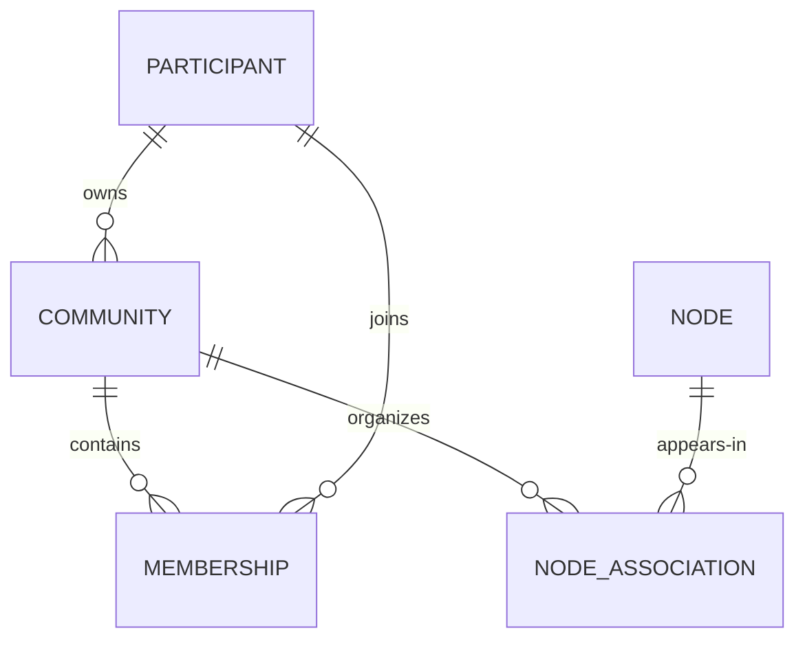

# Communities bounded context

[Domain implementation](../../src/Atlas.Communities/README.md) · [Requirements](../requirements/REQUIREMENTS.md#communities) · [Workflow](../workflows/COMMUNITIES.md)

Communities gives Atlas an optional organizational and discovery layer over Nodes. A Community is public/open in the first implementation. Its creator owns its metadata and lifecycle; eligible participants can view, join, leave, and associate appropriate Nodes.

## Relationships

The two many-to-many relationships are maintained through Community-owned records. `NODE_ASSOCIATION` does not change a Node or its Graph parents.

## Consistency and failures

Atlas.Application supplies the SQL repository adapters selected by host composition for CommunityRows, CommunityMembershipRows, and CommunityNodeRows. SQL Server enforces a unique Community Name index and composite primary keys for (CommunityId, ParticipantId) and (CommunityId, NodeId). Name comparison follows the database collation; application validation also checks names case-insensitively.

Foreign keys enforce references to existing Communities, Participants, and Nodes. NoAction prevents physical deletion while dependents exist; archive preserves references. [CommunityService.Create](../../src/Atlas.Communities/Communities/CommunityService.cs) wraps community creation and owner membership in one operation transaction. A failed membership save rolls back the community too.

- Serializable isolation and constraints protect competing names and memberships; expected SQL conflicts reach the caller as an operation conflict.
- Communities does not request the graph application lock. Ordinary SQL locks still apply.
- Universal stale-edit/version checks and automatic retry remain deferred. See [workflow tests and limits](../security/validation/IMPLEMENTATION.md#workflows-and-evidence).

## Follow-up decisions

- Ownership transfer and the owner's membership lifecycle.
- Removal or suspension of members.
- Community rules and presentation settings.
- Private/restricted discovery and invitation behavior if users request it.
- Versioned events for creation, archive, membership, and node-association changes.
- Stale-edit/version policy, host retry behavior, and failure coverage for future multi-record workflows.
