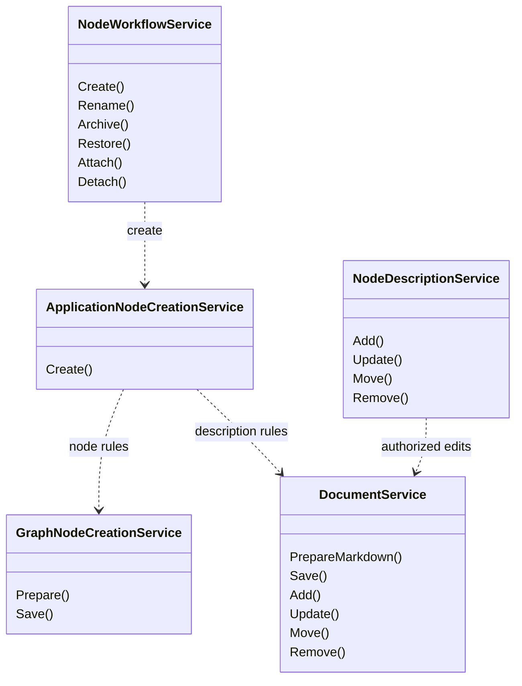
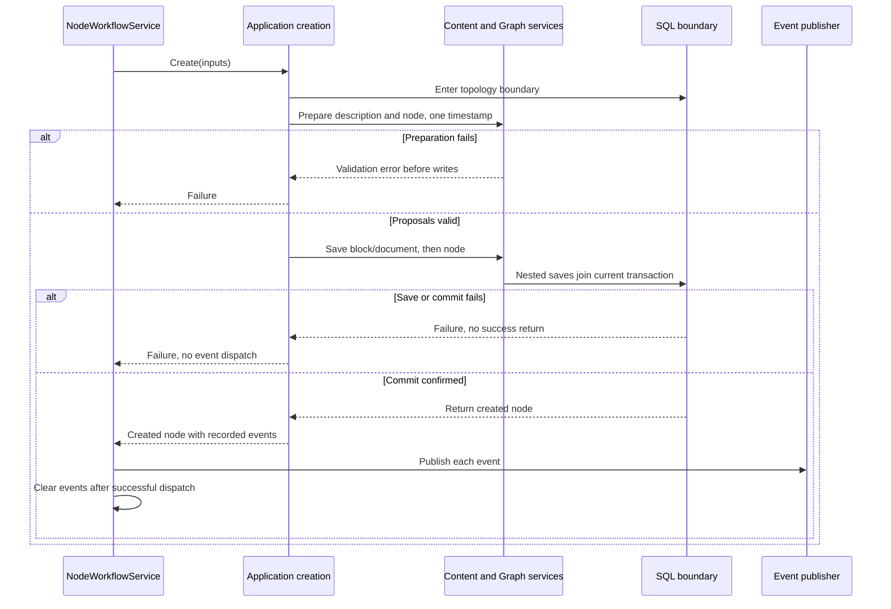
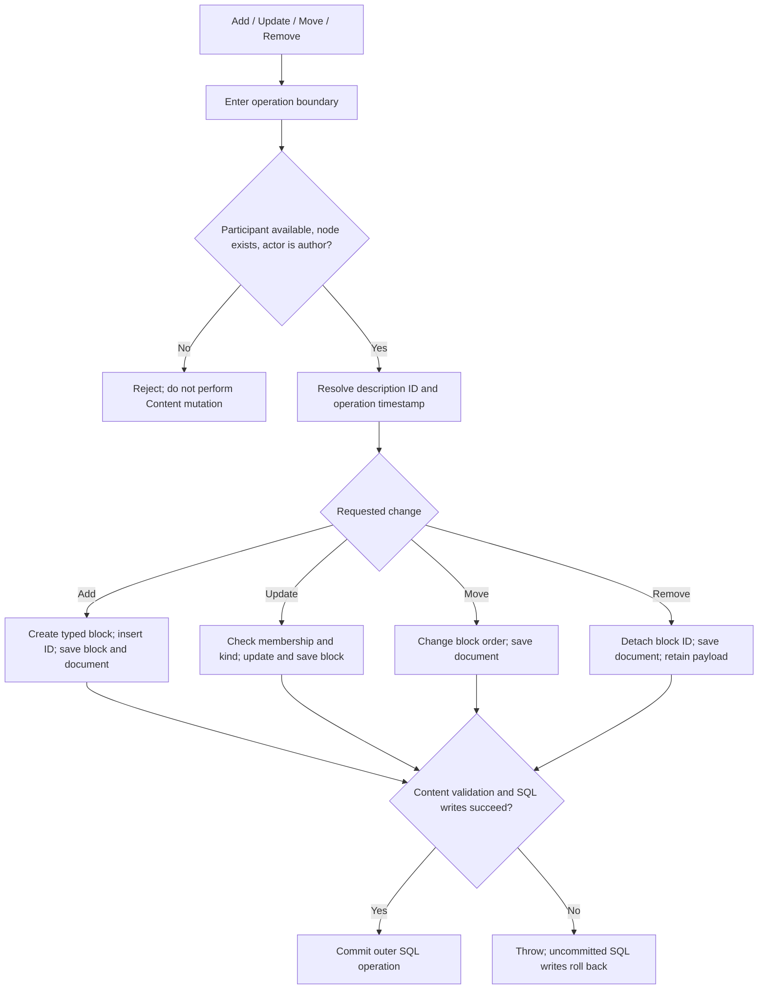

# Nodes and Content: UML and process trees

[Visual guide](README.md) · [Wiring](WIRING.md) · Next: [Reactions and notifications](REACTIONS-AND-NOTIFICATIONS.md) · [Transactions](TRANSACTIONS-AND-EVENTS.md)

## Two domains, one coordinator

The two creation classes have the same short name in different namespaces. **Application** coordinates; **Graph** validates and persists the node. Graph holds a description ID without referencing Content's concrete model. Content owns document composition and block payloads.

Sources: [Application creation](../../../src/Atlas.Application/NodeCreationService.cs#L12), [Graph creation](../../../src/Atlas.Graph/Nodes/NodeCreationService.cs), [DocumentService](../../../src/Atlas.Content/Documents/DocumentService.cs), [NodeWorkflowService](../../../src/Atlas.Application/NodeWorkflowService.cs#L11).

## Creation call order

This preserves coordinated Graph/Content creation while moving the coordination out of the terminal. Graph validates proposed references/ancestry/quota during preparation and checks storage references when saving. The outer SQL topology boundary holds transaction-scoped topology coordination. [Transaction details](TRANSACTIONS-AND-EVENTS.md) explain nested saves and uncertain commit outcomes.

## Description mutation decisions

These are application authorization checks followed by Content invariants. Reference availability alone is not an ownership check. `NodeDescriptionService` reloads the node on every call and calls `EnsureAuthoredBy`; Content loads the description and validates the selected mutation. Update keeps block identity; Remove retains its stored payload. This path does not publish Graph lifecycle events.

Sources: [description entry points](../../../src/Atlas.Application/NodeDescriptionService.cs#L18), [typed BlockInput](../../../src/Atlas.Content/Blocks/BlockInput.cs), [Content mutation methods](../../../src/Atlas.Content/Documents/DocumentService.cs). Verification: [SQL application workflow tests](../../../tests/Atlas.Persistence.Tests/SqlApplicationWorkflowTests.cs).

## Other node mutations

Rename/archive/restore enter an ordinary operation boundary, check current participant/ownership, mutate the supplied node and save metadata. Attach delegates relationship rules to Graph; Detach uses the topology boundary. All dispatch recorded events after their save boundary returns. This reload checks ownership; it is not optimistic version checking of all fields on the supplied node. See [NodeWorkflowService](../../../src/Atlas.Application/NodeWorkflowService.cs#L11) and [workflow regression tests](../../../tests/Atlas.Application.Tests/WorkflowTests.cs).
