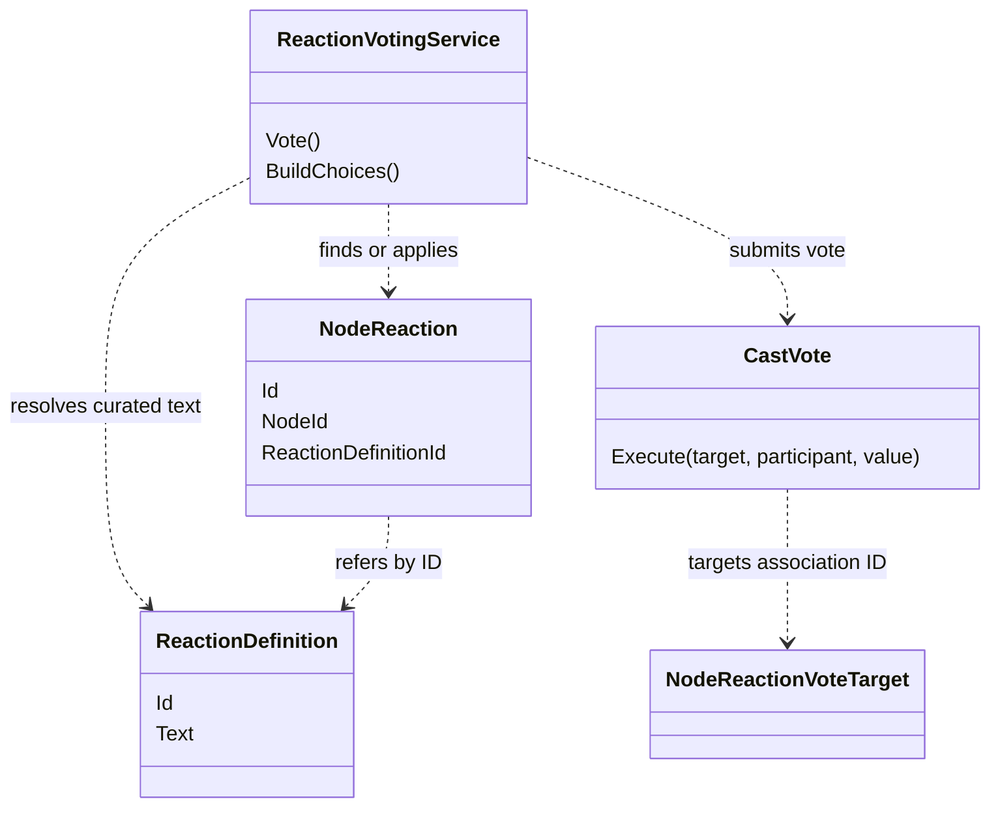
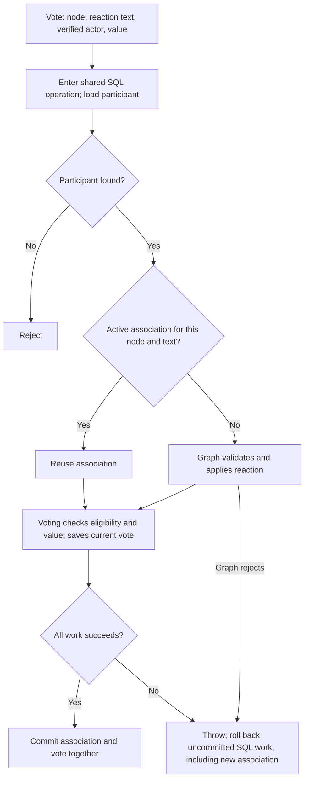
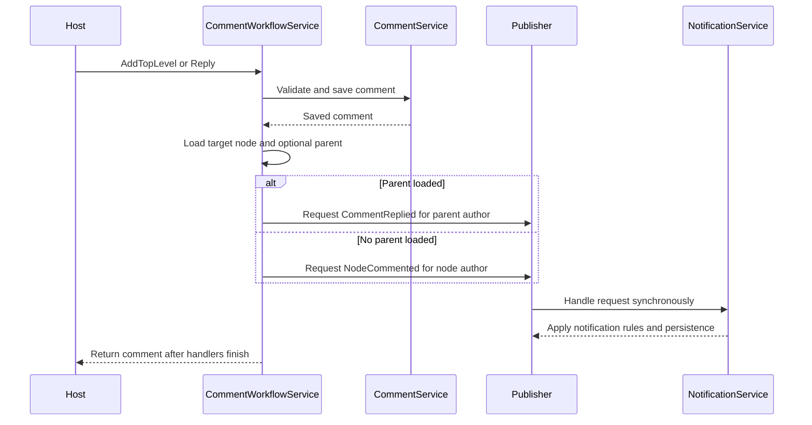
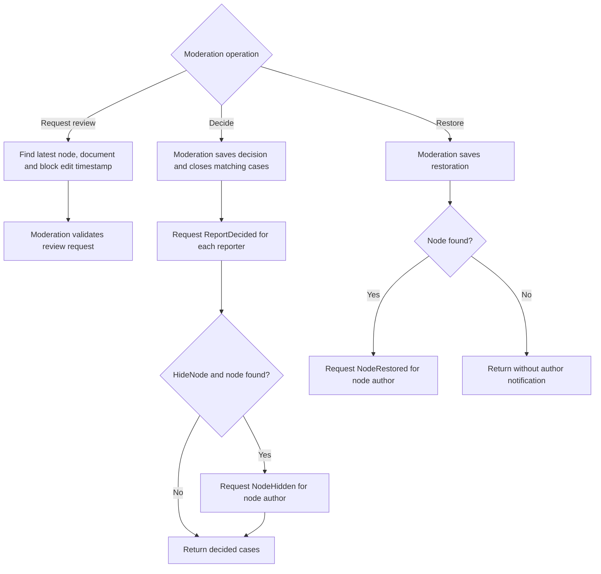

# Reactions and notifications: decisions across domains

[Visual guide](README.md) · [Nodes and Content](NODES-AND-CONTENT.md) · Next: [Transactions and events](TRANSACTIONS-AND-EVENTS.md)

## A reaction definition is not its node association

Definitions describe the curated reaction catalog. An association applies a definition to one node. Votes target that association's ID. `BuildChoices` is read-only: it lists unsuppressed definitions with summaries, including definitions not yet applied to the node; those choices have zero totals and no participant vote.

## Vote process and rollback branch

The shared boundary is an intentional improvement over independently saving the association before voting. A valid association can be reused; a newly created one must not survive a rejected vote. SQL adapters provide that rollback guarantee; arbitrary in-memory implementations need their own boundary support. See [ReactionVotingService](../../../src/Atlas.Application/ReactionVotingService.cs#L25), [Graph application service](../../../src/Atlas.Graph/Reactions/NodeReactionApplicationService.cs), [CastVote](../../../src/Atlas.Voting/CastVote.cs) and [SQL thin-host tests](../../../tests/Atlas.Persistence.Tests/SqlThinHostWorkflowTests.cs).

## Comment save and recipient selection

Recipient selection is the application's job; Notifications owns its handling rules. The current implementation uses the node author if no parent was loaded, including its null fallback. Edit and Remove delegate to Comments without requesting these creation notifications. Comment save and notification handling are separate operations: a failure in lookup or publishing can be reported after the comment was saved.

Sources: [CommentWorkflowService](../../../src/Atlas.Application/Comments/CommentWorkflowService.cs#L22), [Notifications domain](../../../src/Atlas.Notifications), [notification workflow](../../workflows/NOTIFICATIONS.md), [SQL recipient tests](../../../tests/Atlas.Persistence.Tests/SqlThinHostWorkflowTests.cs).

## Moderation routes

The decision tree shows orchestration, not every Moderation authorization branch. Domain rejection or notification-handler failure throws and stops the path. The saved decision/restoration precedes notification publication; requests to multiple recipients are not one all-or-nothing notification batch. See [ModerationWorkflowService](../../../src/Atlas.Application/ModerationWorkflowService.cs#L12), [Moderation architecture](../MODERATION.md) and [SQL thin-host tests](../../../tests/Atlas.Persistence.Tests/SqlThinHostWorkflowTests.cs).
