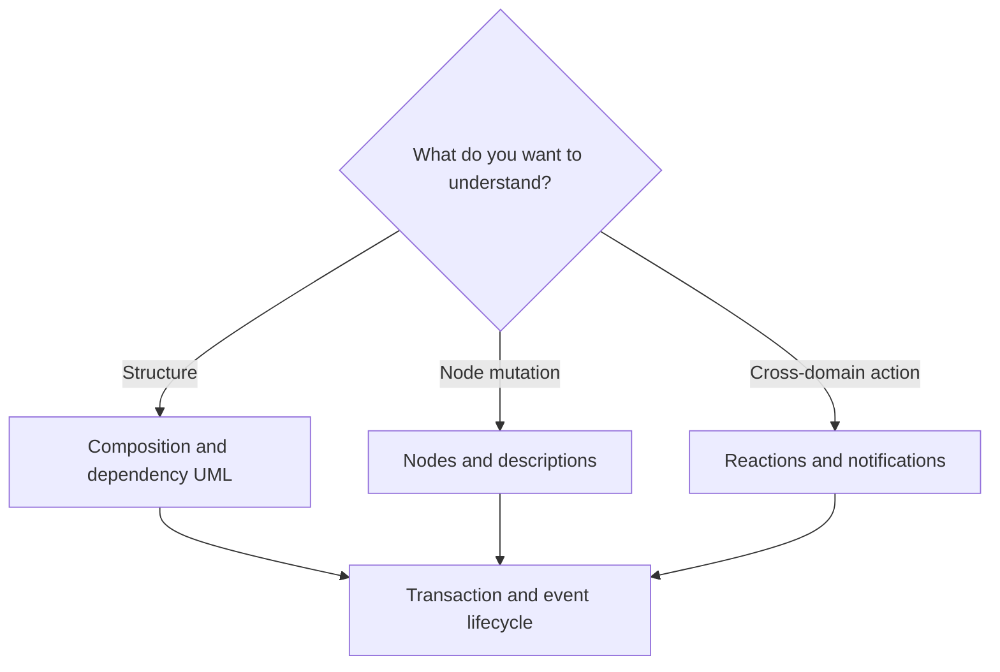

# Atlas visual architecture guide

[Documentation home](../../README.md) · [Architecture](../README.md) · [Ownership guide](../APPLICATION-WORKFLOWS.md)

Start here to follow the PTT-131 thin-host design from the whole application into individual operations. These diagrams describe the implemented console/SQL application. Most rules and transaction mechanics predate the extraction: their new location makes them reusable by another host. Reaction application plus voting is an intentional atomicity improvement.

The diagrams use editable Mermaid source and render directly in GitHub Markdown. UML class views show dependencies and responsibilities; UML sequences show call order; decision/process trees show branches and failure outcomes. Arrows in a class view mean dependency, not necessarily a method call or project reference. Each view is deliberately scoped rather than presenting every class in one canvas. Source links beneath the diagrams lead to the implementation; page links let you move between levels.

## Choose a route

| Question | Detailed view |
|---|---|
| Who wires the application, and what could another host reuse? | [Composition and dependency UML](WIRING.md) |
| How do Graph and Content create one node, and how do description edits work? | [Node and content UML/process trees](NODES-AND-CONTENT.md) |
| Where do association, vote, comment and notification decisions happen? | [Reactions and notifications](REACTIONS-AND-NOTIFICATIONS.md) |
| Who starts, joins, commits or rolls back a transaction? | [Transaction and event lifecycle](TRANSACTIONS-AND-EVENTS.md) |

## Read the design in three layers

The host translates interaction into inputs and supplies verified identity. Application coordinates work spanning domains. Domains enforce their own rules through repository ports; the selected SQL adapters implement those ports and share an EF transaction where a workflow requests one.

Reference validation and authorization are distinct. Checking that a participant is available does not establish that they authored a node. For description mutations, the workflow performs both checks, then Content checks its own document/block rules. A supplied GUID alone does not authenticate a caller.

## A focused PR review

1. Follow startup composition in [WIRING](WIRING.md), including event subscriptions.
2. Trace creation and one description edit in [NODES-AND-CONTENT](NODES-AND-CONTENT.md).
3. Take the failed-vote branch and check notification recipients in [REACTIONS-AND-NOTIFICATIONS](REACTIONS-AND-NOTIFICATIONS.md).
4. Follow a subscriber failure after commit in [TRANSACTIONS-AND-EVENTS](TRANSACTIONS-AND-EVENTS.md).

These views cover the extraction's key review seams. They are an entry point for further domain UML, not an exhaustive model of every aggregate. Existing [domain architecture documents](../README.md), [workflow documents](../../workflows/README.md) and [blackboards](../../blackboards/README.md) provide the next level of detail.
