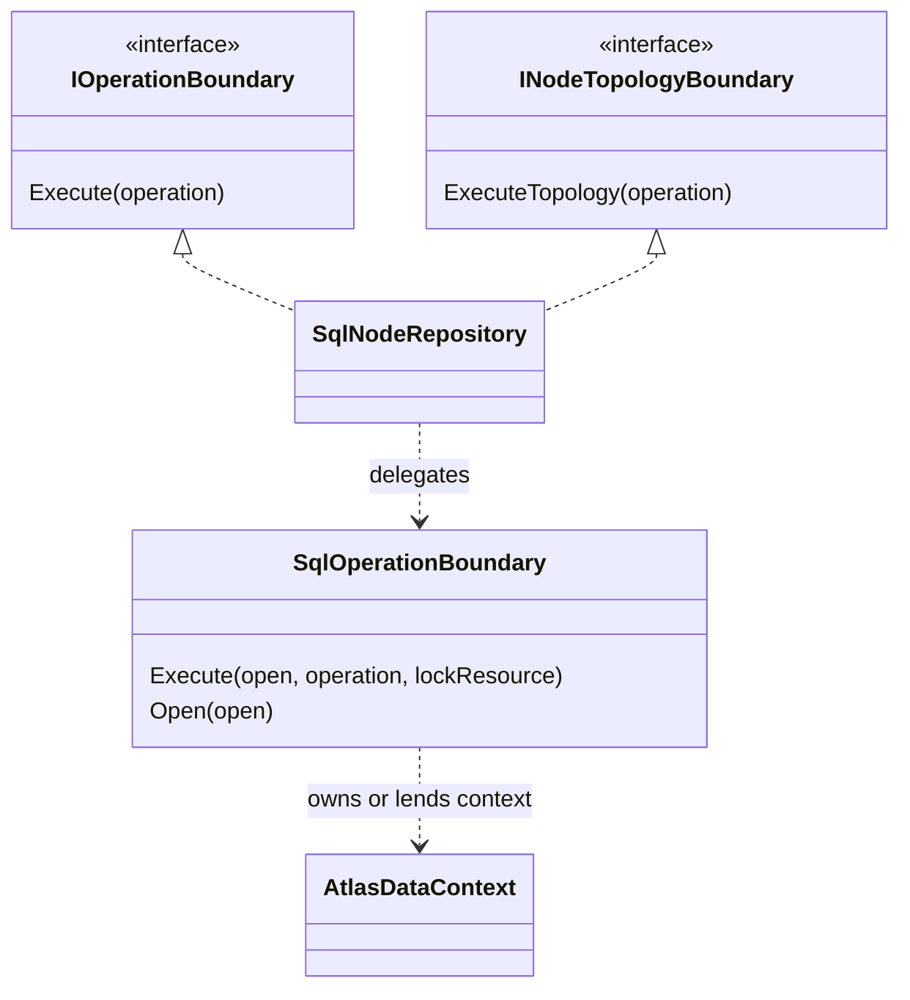
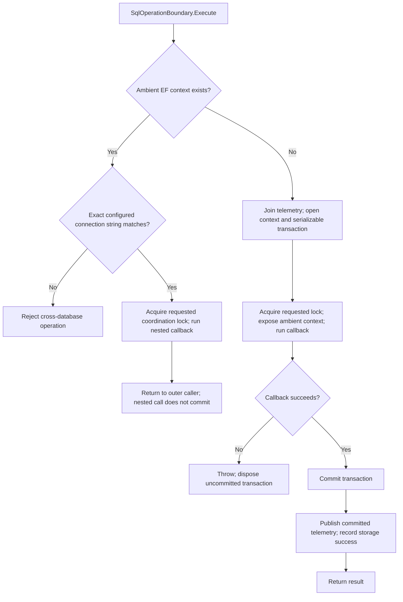
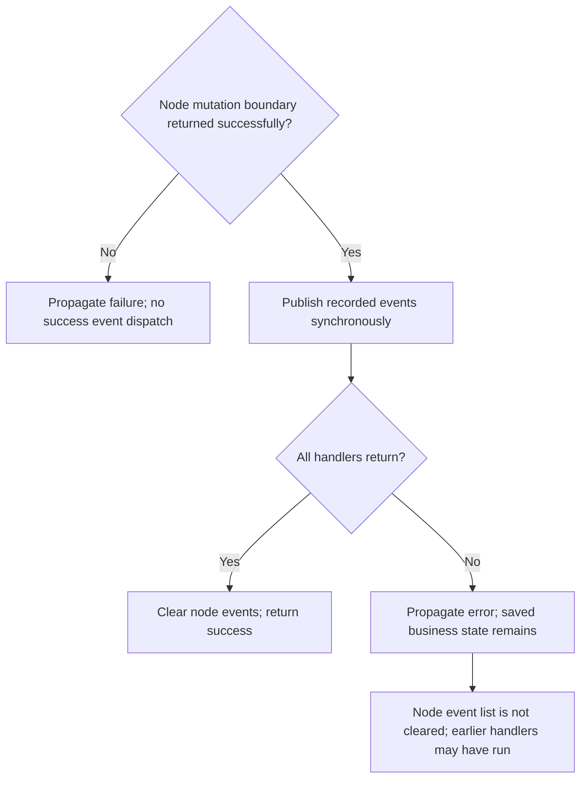

# Transaction and event lifecycle

[Visual guide](README.md) · [Wiring](WIRING.md) · [Nodes](NODES-AND-CONTENT.md) · [Reactions and notifications](REACTIONS-AND-NOTIFICATIONS.md)

## Capabilities connect an interface to SQL behavior

The Contracts `OperationBoundary` helper detects `IOperationBoundary`; Graph's `NodeTopologyBoundary` detects its additional capability. Without a supplied capability they execute the callback through the fallback path; that does not invent a transaction for an arbitrary repository. SQL repositories implement the capabilities and delegate to the shared SQL coordinator.

Sources: [Contracts helper](../../../src/Atlas.Contracts/Operations/OperationBoundary.cs), [Graph topology capability](../../../src/Atlas.Graph/Nodes/NodeTopologyBoundary.cs), [SqlNodeRepository](../../../src/Atlas.Application/Storage/SqlNodeRepository.cs), [SQL coordinator](../../../src/Atlas.Application/Storage/SqlOperationBoundary.cs#L23).

## Entering a SQL boundary

This is one synchronous execution flow. `AsyncLocal` carries the current context for nested calls; it does not make EF thread-safe. Do not start parallel repository work on that context. The outer owner clears the ambient slot in `finally` and disposes its context/transaction. Nested repository context leases borrow that context and do not dispose it.

Ordinary operations use serializable isolation. Topology operations additionally request the transaction-owned `AtlasGraphTopology` application lock. The lock coordinates topology work; transaction atomicity comes from the SQL transaction itself.

The happy-path tree omits exception edges from opening, locking, committing and post-commit telemetry. Failure before a confirmed commit leaves uncommitted work to roll back on disposal. A commit exception can leave the outcome uncertain; a failure after commit cannot roll back persisted data. Recognized SQL/EF conflicts are translated to `OperationConflictException`. The implementation emits telemetry for those distinctions; an exception alone is not proof that nothing was saved.

## Event delivery after saving

For `NodeWorkflowService`, clearing happens after the entire dispatch loop. This is not automatic retry: retrying publication could call an earlier handler again, and losing the in-memory node loses its pending list. The publisher does not catch subscriber failures, persist messages or guarantee delivery. An event with no registered handlers returns normally. Comments and Moderation construct notification requests directly after saving rather than draining a node event list.

The durable **audit outbox** is a separate mechanism. It does not make these domain events or notification requests durable. Follow [Audit Delivery](../../security/observability/AUDIT-DELIVERY.md) only for that separate pipeline.

Sources: [NodeWorkflowService dispatch](../../../src/Atlas.Application/NodeWorkflowService.cs#L53), [InMemoryEventPublisher](../../../src/Atlas.Application/Eventing/InMemoryEventPublisher.cs). Verification: [workflow tests](../../../tests/Atlas.Application.Tests/WorkflowTests.cs), [SQL operation tests](../../../tests/Atlas.Persistence.Tests/SqlOperationValidationTests.cs), [SQL workflow tests](../../../tests/Atlas.Persistence.Tests/SqlThinHostWorkflowTests.cs).

## What parity means for this refactor

| Preserved mechanism | New organization or intentional change |
|---|---|
| Shared SQL transactions, reference validation and topology coordination | SQL adapters moved from Console to Application.Storage |
| Domain ownership, availability and validation rules | Reusable Application coordinates the cross-domain paths |
| Saving before synchronous event handling | Event publisher and recipient selection moved out of menus |
| Graph reaction and Voting policies | Application now wraps association plus vote in one shared boundary |

The extraction aims to preserve existing behavior while making the host replaceable. These diagrams expose the seams for review; the linked tests provide executable evidence of selected paths rather than proof of every possible interaction.
