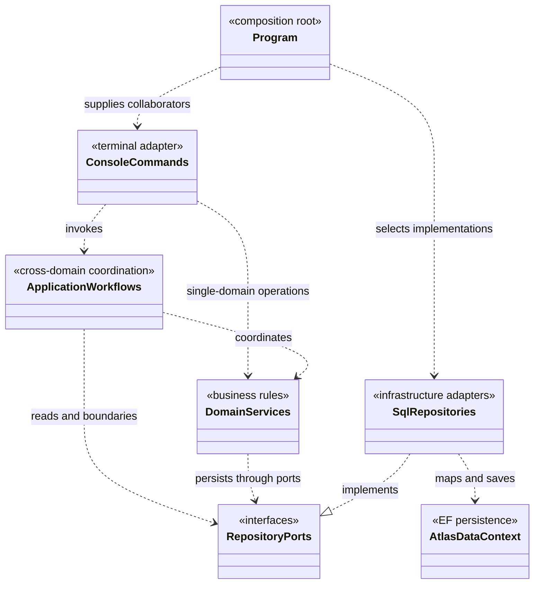
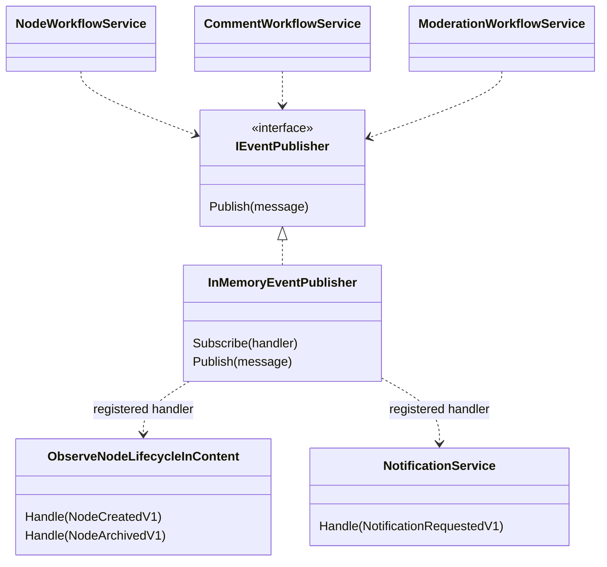

# Composition and dependency UML

[Visual guide](README.md) · Next: [Nodes and Content](NODES-AND-CONTENT.md) · [Transaction details](TRANSACTIONS-AND-EVENTS.md)

## Startup selects implementations

This UML view models composition roles, not a complete constructor or assembly-reference listing. Program creates repositories, domain services and subscriptions; console commands construct/use application workflows with those collaborators. No DI container is required for that manual wiring. Identity does use a service collection.

The grouped ports stand for interfaces such as `INodeRepository`, `IDocumentRepository` and `IVoteRepository`; there is no single `RepositoryPorts` class. Application cannot reference Infrastructure, Persistence, Identity or Console. At runtime, a variable typed as a domain interface holds a SQL implementation. Dependency inversion allows the call to reach SQL without Application knowing EF types.

| Role | Source |
|---|---|
| Configuration, repository selection, domain services, subscriptions | [Console Program](../../../src/Atlas.Console/Program.cs) |
| Reusable use cases and adapters | [Application project](../../../src/Atlas.Application/README.md) |
| Concrete SQL ports | [Infrastructure Storage](../../../src/Atlas.Infrastructure/Storage) |
| EF model and save/audit integration | [AtlasDataContext](../../../src/Atlas.Persistence/AtlasDataContext.cs) |
| Dependency assertions | [ArchitectureTests](../../../tests/Atlas.Application.Tests/ArchitectureTests.cs) |

## Events are wired separately from repository dependencies

Program registers the Content observer for `NodeCreatedV1` and `NodeArchivedV1`, and NotificationService for `NotificationRequestedV1`. The Content observer confirms document existence and optionally reports a diagnostic observation; it does not create/delete the description. The description is already saved during creation and retained when archived.

See [publisher](../../../src/Atlas.Application/Eventing/InMemoryEventPublisher.cs), [Content observer](../../../src/Atlas.Application/Content/ObserveNodeLifecycleInContent.cs) and [Program subscriptions](../../../src/Atlas.Console/Program.cs). [Event failure semantics](TRANSACTIONS-AND-EVENTS.md#event-delivery-after-saving) matter when reviewing these arrows.

## What changes for an API host?

| Reuse | Supply in the new host |
|---|---|
| Application workflows and domain policies | Endpoints, request models, response/error mapping |
| Infrastructure repositories and SQL boundaries | Configuration and service lifetimes |
| Event handlers and publisher implementation | Explicit subscription wiring |
| Contracts identity abstraction | Verified request identity through `IAuthenticatedActor` |

The API is future work, not a currently wired executable. It must load server-side domain state rather than trust client-supplied domain objects. Console session handling stays in Console; [SessionParticipantQuery](../../../src/Atlas.Identity/SessionParticipantQuery.cs) owns its reusable EF profile lookup. See the [ownership guide](../APPLICATION-WORKFLOWS.md#verification-and-future-api-composition) for the composition recipe.
