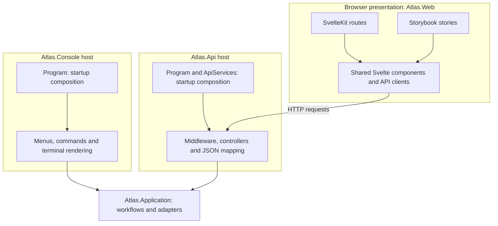
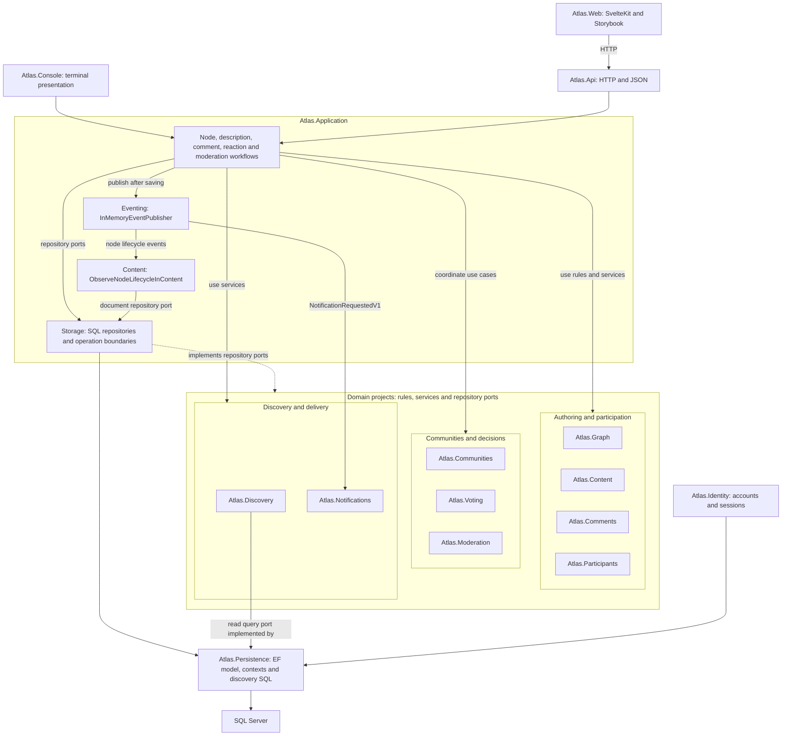
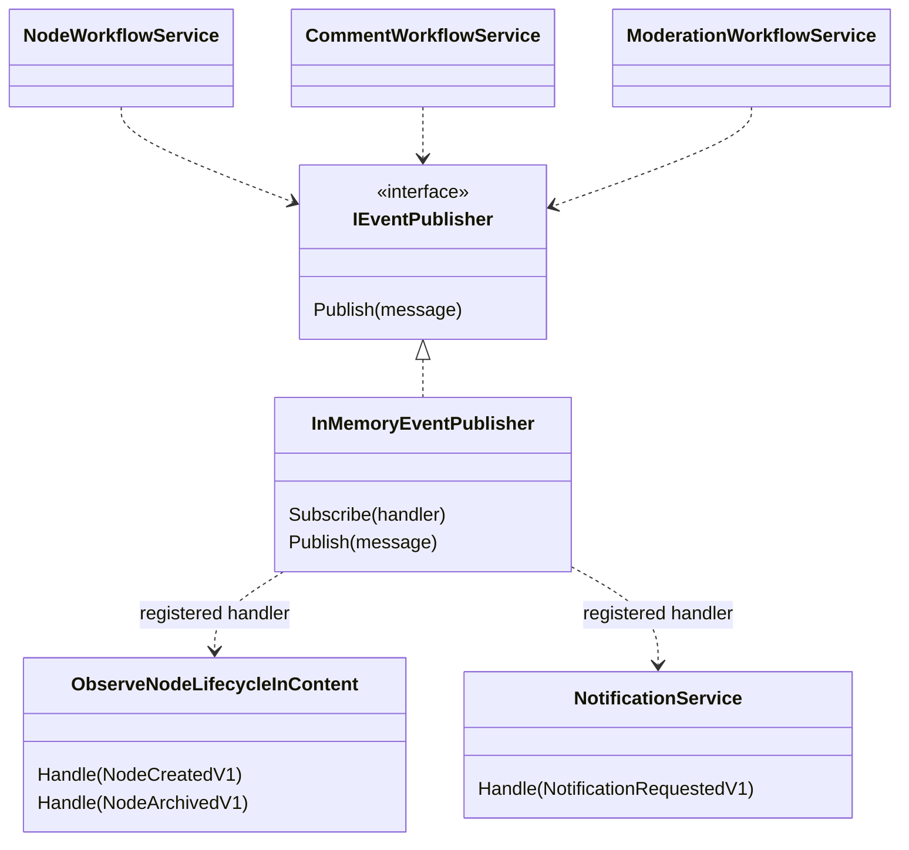

# Application wiring and presentation ownership

[Visual guide](README.md) · [Ownership guide](../APPLICATION-WORKFLOWS.md) · [Transaction details](TRANSACTIONS-AND-EVENTS.md)

Atlas has two backend hosts: Console and the JSON REST API. Each host translates its own interaction into reusable application/domain operations and chooses infrastructure at startup. **Thin describes responsibility, not program length.** Console owns its terminal presentation; the API owns HTTP behavior and JSON contracts. Browser presentation belongs to SvelteKit. Storybook imports the same frontend components to exercise them independently of application routes.

## Presentation reaches a shared backend

The arrows show composition or request flow, as labeled; they are not a complete assembly-reference graph. Console and the API are independent entry points. Neither calls the other. Both can use the same configured database and reuse the same backend operations. SvelteKit does not load .NET domain entities or connect directly to SQL.

Storybook owns stories, preview configuration and navigation adapters. Production components, styles and API clients live under `Atlas.Web/src`; they are reused by routes and stories. Isolated examples and browser tests can simulate responses, while live compositions use the real API. Passing an isolated story does not establish live backend correctness.

## Atlas.Application connects domains, events and storage

The `Atlas.Application` boundary represents the actual project. The domain groups organize the individual projects for readability; they are not additional assemblies. Arrows show selected runtime collaborations, not every project reference or a requirement that every request visit every domain. Hosts can also call single-domain services directly. The workflow-to-storage arrows pass through domain-owned interfaces such as `INodeRepository`, `IDocumentRepository` and `IVoteRepository`; domain rules do not depend on concrete SQL adapters. Discovery's read-query implementation lives in Persistence rather than Application.Storage.

Application owns the workflow implementations, in-memory event publisher, Content observer and concrete SQL repository adapters. Persistence owns EF mappings, contexts and discovery SQL. Identity owns account/session integration and uses Persistence. Shared event and boundary types live in `Atlas.Contracts` (omitted from the flow to keep it readable).

## Startup chooses implementations and lifetimes

The hosts are still the **composition roots**. Owning the implementation and wiring it at startup are different responsibilities:

| Owner | Startup or runtime responsibility |
|---|---|
| Console Program | Reads configuration, calls `SqlStorage.Configure`, constructs repositories/workflows, and registers event subscribers. Console's storage setup applies migrations. |
| API ApiServices | Configures `UseSqlServer`, registers a fresh-context factory, repositories/workflows, service lifetimes and event subscribers. API startup does not migrate the database. |
| Application workflows | Coordinate use cases through domain services and repository ports; publish relevant events after saving. They do not select the connection string or configure SQL Server. |
| Application.Storage | Opens contexts through the configured factory and coordinates repository operations/transactions. |
| Application.Eventing | Implements synchronous in-process dispatch; the hosts register Content and Notification handlers. It is not a durable message broker. |

Thus, a thin host does wire infrastructure at startup today. It delegates reusable use cases and persistence behavior to the owning projects. Moving that registration into a shared Application extension would be a code refactor; this diagram describes the existing implementation.

| Responsibility | Current source |
|---|---|
| Terminal composition, presentation and console session | [Console Program](../../../src/hosts/Atlas.Console/Program.cs), [ConsoleApplication](../../../src/hosts/Atlas.Console/ConsoleApplication.cs) |
| HTTP pipeline and dependency injection | [API Program](../../../src/hosts/Atlas.Api/Program.cs), [ApiServices](../../../src/hosts/Atlas.Api/ApiServices.cs) |
| HTTP identity, operation context and error mapping | [ApiBoundary](../../../src/hosts/Atlas.Api/ApiBoundary.cs) |
| Browser routes and reusable UI | [SvelteKit routes](../../../src/hosts/Atlas.Web/src/routes), [components](../../../src/hosts/Atlas.Web/src/lib/components), [API clients](../../../src/hosts/Atlas.Web/src/lib/api) |
| Storybook imports and preview setup | [Stories](../../../src/hosts/Atlas.Web/storybook), [main.ts](../../../src/hosts/Atlas.Web/.storybook/main.ts), [preview.ts](../../../src/hosts/Atlas.Web/.storybook/preview.ts) |
| Use cases and concrete repository implementations | [Application](../../../src/Atlas.Application/README.md), [Storage](../../../src/Atlas.Application/Storage) |
| EF mappings and persistence/audit integration | [AtlasDataContext](../../../src/Atlas.Persistence/AtlasDataContext.cs) |
| Host and domain dependency checks | [ArchitectureTests](../../../tests/Atlas.Application.Tests/ArchitectureTests.cs) |

Console constructs most collaborators manually and uses a service collection for Identity. The API uses dependency injection: repository adapters, workflows, the event publisher and `RequestActor` are request-scoped; the context factory, discovery cache and telemetry have host lifetime. The factory creates fresh contexts rather than sharing one context across requests. Console owns/disposes its discovery cache; API DI owns its singleton cache. The two processes do not share cache memory. See [discovery wiring and cache lifetime](../discovery-read-query.md#host-wiring-and-cache-lifetime).

Hosts establish verified identity. Console retains its terminal sign-in/session behavior; API middleware resolves an eligible participant from the authenticated principal and supplies `RequestActor` to controller operations. Client JSON or a supplied participant GUID is not authentication. Domain/application ownership checks remain authoritative even when the frontend hides edit controls.

## Local development and diagnostics

The [shared Vite proxy](../../../src/hosts/Atlas.Web/dev/localApi.ts) is used by the app's [Vite configuration](../../../src/hosts/Atlas.Web/vite.config.ts) and Storybook's development configuration. Public routes forward anonymous allowlisted reads; session routes allow selected authenticated reads/writes and preserve backend cookie/CSRF protections. This is development routing, not the production hosting/security boundary. Static builds need equivalent deployment routing. The API remains JSON-only; it does not render the SvelteKit interface.

`Atlas.RankingLab` is an additional local diagnostics host, not a production API or another application presentation layer. The ranking story uses a separate loopback bridge to read the local Atlas database and explain the same persistence search query. It does not create/reset application data. Controlled SQL fixtures remain regression-test inputs separately from the live workbench. See [ranking diagnostics](../../discovery/search-ranking-workbench.md) and [frontend startup](../../../src/hosts/Atlas.Web/README.md).

## Events are wired separately from repository dependencies

Console Program and API `ApiServices` register the Content observer for `NodeCreatedV1` and `NodeArchivedV1`, and NotificationService for `NotificationRequestedV1`. The Content observer confirms document existence and optionally reports a diagnostic observation; it does not create/delete the description. The description is already saved during creation and retained when archived.

See [publisher](../../../src/Atlas.Application/Eventing/InMemoryEventPublisher.cs), [Content observer](../../../src/Atlas.Application/Content/ObserveNodeLifecycleInContent.cs) and [Console subscriptions](../../../src/hosts/Atlas.Console/Program.cs) and [API registrations](../../../src/hosts/Atlas.Api/ApiServices.cs). [Event failure semantics](TRANSACTIONS-AND-EVENTS.md#event-delivery-after-saving) matter when reviewing these arrows.

## Extending or replacing a host

Reuse application workflows, domain policies, contracts and appropriate adapters. A new host supplies interaction/presentation mapping, verified identity, configuration, service lifetimes, subscriptions and error handling. It must reload server-side state rather than trust client-supplied domain objects. Replacing SQL also requires adapters that satisfy the existing transaction, reference-validation and topology guarantees; implementing repository signatures alone is insufficient.

The current examples are the implemented Console and API hosts, not a proposal to add the API later. [Detailed workflow ownership](../APPLICATION-WORKFLOWS.md) and the [API code walkthrough](../../api/CODE-GUIDE.md) provide the next level of detail.
