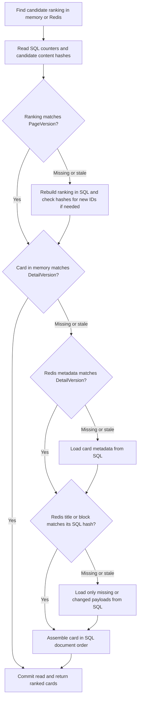

# Discovery cache (PTT-184)

Atlas keeps Discovery rankings and assembled cards in process memory for up to
30 seconds by default. An optional Redis cache preserves public feed data across
API restarts. SQL Server owns freshness, ranking, and visibility.

## What Redis stores

| Entry | How Atlas checks freshness |
| --- | --- |
| Ranked page | SQL page revision for the cached ranking, keyed by query and page |
| Card metadata | Shared SQL detail revision for author, breadcrumbs, reactions, and other card details |
| Title | SQL hash of the title |
| Document block | SQL hash of the block fields, including composition JSON |

Redis covers paged public Discovery, including filtered pages. Full-text search
rankings run in SQL so asynchronous index updates can appear in the results.
Those results can still reuse public card data. Authored and moderator views
use in-process caching. Atlas queries personalized votes separately.

## Request walkthrough: counters and hashes

The counters answer whether Atlas can reuse a ranked page or card details.
`PageVersion` protects the ranking. `DetailVersion` protects assembled cards
in memory and shared card metadata in Redis. Content hashes answer a narrower
question: whether a specific title or block in Redis still matches SQL. Atlas
gets both kinds of versions in the same SQL batch for candidate IDs from a
cached ranking.



Atlas resolves each selected card and batches the Redis title and block
lookups. For example, when one block is edited, the ranking and card metadata
can need rebuilding while the title and sibling blocks still match their SQL
hashes. Atlas reuses those payloads and fetches the edited block. Newly loaded
entries are published after the SQL snapshot commits.

Cards include up to eight eligible rich preview blocks in document order.
Oversized blocks are omitted from the preview. When the combined preview
exceeds the JSON size limit, the card uses its text excerpt. The full post
loads its own description.

## Retention and SQL fallback

Redis keys use the database-scoped `atlas:discovery:v2:` namespace. Entries
have no time-based expiration and are limited to 128 KiB each. A rebuild
overwrites the entry for the same key. Enable eviction on the dedicated Redis
database so it can make room for new entries.

Redis failures fall back to SQL with a brief retry cooldown. When restoring or
replacing SQL under the same server and database name, stop the API and clear
the associated Redis entries before restarting. A restored database can reuse
revision numbers.

A warm page still opens a SQL connection and reads and hashes content on the
server. The cache reduces payload loads and rebuild work. A warm Redis hit can
still wait for Azure SQL to resume. The version checks require no migration.

## Test an API restart locally

From the repository root in PowerShell, use your existing seeded local SQL
database. Start Redis in Docker Desktop and verify that it responds.

```powershell
docker run -d --name atlas-discovery-redis -p 127.0.0.1:6379:6379 redis:7.4-alpine
docker exec atlas-discovery-redis redis-cli ping
```

In the API terminal, set the connection and start the API. Keep the same
terminal and settings when restarting.

```powershell
$env:ATLAS_DISCOVERY_REDIS_CONNECTION = 'localhost:6379'
$env:ATLAS_TELEMETRY_DIRECTORY = Join-Path (Get-Location).Path 'logs/observability'
dotnet run --project src/hosts/Atlas.Api --launch-profile https
```

1. In a second terminal request a populated page. Use the exact same URL
   before and after the restart.

   ```powershell
   Invoke-RestMethod 'https://localhost:7240/api/nodes?page=1'
   docker exec atlas-discovery-redis redis-cli --scan --pattern 'atlas:discovery:*'
   ```

   A populated page normally writes a ranking key, card metadata, titles, and blocks.
2. Press **Ctrl+C in the API terminal**, leave Redis and SQL running, and
   rerun the same `dotnet run` command. Request the same URL again before
   any changes that invalidate the cached results.
3. Examine the newest phase records from the API.

   ```powershell
   Get-ChildItem (Join-Path (Get-Location).Path 'logs/observability') -Filter 'metrics*.jsonl' |
     Sort-Object LastWriteTime | Select-Object -Last 1 |
     Get-Content | Select-String 'atlas.discovery.phase.duration' | Select-Object -Last 12
   ```

   The restart request should record one `RevisionCheck` and Redis
   `ExternalRead` hits, with no `PageRebuild` or `DetailRebuild` for that request.
   For a comparison, stop Redis with `docker stop atlas-discovery-redis`,
   restart the API again, and repeat the request. The same page should load
   with SQL rebuilds.
4. To run the automated equivalent with a disposable SQL test database, set
   `ATLAS_DISCOVERY_REDIS_TEST_CONNECTION=localhost:6379` and your existing
   `ATLAS_SQL_TEST_CONNECTION_STRING`, then run
   `dotnet test tests/Atlas.Persistence.Tests --filter FullyQualifiedName~RedisDiscoveryCacheTests`.

[Local API setup](../api/README.md) covers SQL credentials and development HTTPS.

## Watch cache sources while browsing

For LAN development, add `ATLAS_DISCOVERY_REDIS_CONNECTION=127.0.0.1:6379`
to `src/hosts/Atlas.Web/.env.lan.local` while using local Docker Redis. Remove
any old shell override of `ATLAS_TELEMETRY_DIRECTORY` to use the default
gitignored `logs/observability/` at the checkout root.

From `src/hosts/Atlas.Web`, start `npm run dev:lan:api`, then open or scroll
Discovery. In a second terminal in the Web directory, run:

```powershell
npm run audit:discovery-cache
```

Rerun the command for a fresh snapshot of the newest metrics file. It reads
the same LAN settings file as the launcher, and an explicit shell override
should be set in both terminals if used.

Each row is one completed Discovery read. A page ranking comes from
`ProcessMemory`, `Redis`, or `Sql`. Card counts can be mixed. The Redis and SQL columns report where card metadata was obtained. Individual title or block misses can still trigger SQL reads. A cold fetch may show SQL for the ranking and three
cards. Repeat the same request promptly to see process memory. Restart only
the API and repeat it while the entries are still in Redis to see Redis. If scrolling
only reuses results in the browser, there is no new API row. Use the
browser's Network tab or repeat the exact feed URL to force a request.

After an API restart, rerun the command to read the new metrics file.
Match `operation_id` with the phase records in that file to inspect the SQL
revision check or Redis failure/backoff. The summary records counts and cache
sources locally. Cloud telemetry continues to report aggregate phase metrics.

## Configure Demo in Azure

Once demo SQL is available:

1. Create a Free Redis database in the [Upstash Console](https://console.upstash.com/)
   in the closest available region. Enable **Eviction** under the database’s
   configuration so Redis can make room for new cache entries. Copy its Redis protocol host, port and
   password from the connection details. The HTTP REST endpoint and token are
   for HTTP clients.
2. Set the GitHub Actions secret `ATLAS_DISCOVERY_REDIS_CONNECTIONS` on the
   repository, or in the environment used by Azure Plan and Apply. Store a JSON
   object with the demo TLS connection (substitute your actual host, port,
   and password).

   ```json
   {"demo":"YOUR_HOST:6379,ssl=true,user=default,password=YOUR_PASSWORD"}
   ```

   The same secret format accepts a `live` key with a separate database and
   credential when live is ready. Keep this value in secrets because Terraform
   configures it as an App Service setting and persists it in the protected state.
3. Run **Atlas Azure Terraform plan** on `ptt-184-discovery-read-cache`
   with `installation=main` and `deployment_shape=demo`. Verify the demo API
   app settings change. Run the matching **Atlas Azure Terraform apply** with
   the same inputs, then deploy the API from that branch to demo. Terraform wires the
   service into App Service. Upstash database creation is handled in the
   console so the Free plan can be selected directly.
4. Warm a populated page, restart only the demo API, and repeat the exact
   request before making changes that invalidate the cached results. In
   Application Insights, compare
   `atlas.discovery.phase.duration` by phase and outcome for revision checks,
   page rebuilds, detail rebuilds and Redis reads. Compare Redis command usage
   and request latency in the same window. Compare Azure SQL CPU and reads under a matched workload, and record wake-up latency separately.

[Upstash pricing](https://upstash.com/pricing/redis) lists the Free plan limits
and Pay-as-you-go pricing. Azure Managed Redis uses a separately priced cache
tier. Both the demo and live API use the same Redis protocol and App Service
settings, with deployment-specific credentials.
