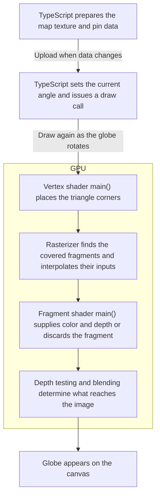

# Learning WebGL through the Atlas globe

This guide follows the code in this branch. Start with the Storybook playground, then read the implementation a piece at a time. You do not need to learn a game engine first.

## What WebGL does here

The browser still displays a rectangular `<canvas>`. WebGL supplies its pixels using small programs called **shaders**, usually executed on the GPU. JavaScript prepares the data, sends it to WebGL, and asks it to draw. The GPU can run the same calculations across many vertices or pixels in parallel.

| Renderer | What our code asks the browser to do during rotation |
| --- | --- |
| SVG | Update the coordinates of individual shaft, head and highlight elements, plus projected map paths. |
| Canvas 2D | Project the map and pins in JavaScript, then issue drawing commands to one bitmap. |
| WebGL 2 | Reuse uploaded positions and a map image; change the camera angle and draw batches on the GPU. |

WebGL is the sole globe renderer in both the application and Storybook; the earlier SVG and Canvas 2D implementations were removed after the visual comparison. The table above explains the approaches we explored.

D3 still has a role. It produces the geographic map image that WebGL samples. We use native WebGL 2, with no Three.js or scene-graph library. The view keeps the same orthographic presentation: distant parts do not shrink as they would with a perspective camera.

## A reading order

Paths below are relative to this guide. The frontend root is `src/hosts/Atlas.Web`.

| Read | Responsibility |
| --- | --- |
| [VisitorGlobe.svelte](../../src/hosts/Atlas.Web/src/lib/components/VisitorGlobe.svelte) | Loads local map data, prepares pin geometry, selects the renderer. |
| [pinGeometry.ts](../../src/hosts/Atlas.Web/src/lib/globe/pinGeometry.ts) | Converts latitude/longitude into fixed 3D positions and a repeatable outward lean. |
| [WebGLGlobe.svelte](../../src/hosts/Atlas.Web/src/lib/components/WebGLGlobe.svelte) | Connects Svelte props, canvas size, context lifecycle and drawing. |
| [webglRenderer.ts](../../src/hosts/Atlas.Web/src/lib/globe/webglRenderer.ts) | Creates shaders, uploads data and issues GPU drawing commands. |
| [VisitorGlobeExample.svelte](../../src/hosts/Atlas.Web/storybook/VisitorGlobe/VisitorGlobeExample.svelte) | Supplies demo settings and the shared animation clock. |
| [globe-webgl.spec.ts](../../src/hosts/Atlas.Web/tests/globe-webgl.spec.ts) | Verifies uploads, drawing, cleanup, unavailable contexts and restoration. |

## The vocabulary in our code

| Term | Meaning here |
| --- | --- |
| Vertex | A corner of a triangle. Two triangles make a rectangular drawing surface. |
| Vertex shader | Positions those corners in the view, using pin data and the current camera angle. |
| Fragment shader | Calculates the color and depth for a candidate pixel covered by a triangle. |
| Program | A linked vertex shader and fragment shader. We have an Earth program and a pin program. |
| Attribute | Input associated with vertices or instances: our pin base, head and color. |
| Uniform | A value shared by a draw call, such as camera angle, head radius or shaft color. |
| Buffer | GPU storage containing the numeric pin records uploaded by JavaScript. |
| VAO | A vertex array object. It remembers how to interpret that buffer as attributes. |
| Texture | An image the fragment shader can sample. Ours contains land and grid lines. |
| Instance | Another copy of a shape, positioned using a different pin record. |
| Depth buffer | Stored distances that let WebGL reject surfaces hidden by nearer surfaces. |

The shader strings use GLSL, a different language from TypeScript. `vec2`, `vec3` and `vec4` hold two, three and four numbers. `mix(a, b, t)` interpolates between values. `uniform` declares shared inputs, while `in` and `out` connect stages. `gl_Position` is the vertex shader's output position; our fragment shaders write their output color and, for Earth, an explicit depth.

## From TypeScript to the canvas

TypeScript prepares the data and asks WebGL to draw. The GPU then runs the vertex and fragment shaders at different stages.



For the **Earth draw**, the vertex shader places two triangles that form a rectangle. The rasterizer fills in the positions between their corners. At each candidate fragment, the Earth fragment shader checks whether that position is inside the circle. Inside the circle, it reconstructs the sphere’s front surface, looks up the map color, and writes the surface depth.

The **pin draws** come afterward. Their vertex shader places the shafts and heads. As those fragments reach the depth test, WebGL compares them with the depth Earth already wrote. That’s how the flat rectangle can hide a pin behind the globe as though it were a sphere.

## Follow one pin from coordinates to pixels

`preparePin()` first turns longitude and latitude into a point on a sphere:

```text
x = cos(latitude) * cos(longitude)
y = cos(latitude) * sin(longitude)
z = sin(latitude)
```

Angles must be in radians. This unit vector points outward from Earth's center. Multiplying it by the globe radius, 176, gives the shaft's base.

The head is farther along an outward direction. A small contribution from the local east/north directions creates lean. Its bearing comes from a deterministic function of the location, so it stays attached to the same place during rotation and snapshot refreshes. A saved pin supplies its user-selected hex color. Synthetic Storybook fixtures choose palette colors independently of location and lean; missing colors retain a deterministic palette fallback for standalone renderer fixtures. The API supplies red for older persisted pins without a saved color.

`setPins()` packs each pin into nine floating-point values: three for its base, three for its head, and three for its RGB color. A `Float32Array` holds these records. Each record occupies 36 bytes; 10,000 records occupy about 360,000 bytes before other graphics resources. `bufferData(..., STATIC_DRAW)` uploads them. The usage hint describes our intent to reuse the data; it is not a prohibition on future updates.

`vertexAttribPointer()` describes each field's size and offset. `vertexAttribDivisor(..., 1)` tells WebGL to advance that field once per **pin instance**, rather than once per triangle corner.

The pin vertex shader's `camera()` rotates the 3D positions around Earth, then applies the same 18-degree tilt used by D3. Screen X/Y determine placement; the remaining coordinate supplies depth. Dividing by 220 maps our 440-unit view into WebGL's visible horizontal and vertical range of -1 to 1.

For a shaft, the shader forms a thin rectangle between the projected base and head. For a head, it forms a square centered on the projected head; the fragment shader discards pixels outside a circle. Round heads add a small elliptical highlight. These are **camera-facing shapes positioned in 3D**, not detailed spherical pin meshes. This preserves the existing illustration style.

## Why two pin draw calls can draw thousands of pins

The `corners` shader constant describes six vertices: two triangles forming one rectangle. `gl_VertexID` selects a corner without needing a separate corner buffer.

`drawArraysInstanced(TRIANGLES, 0, 6, count)` repeats that rectangle for every pin record. One call draws all shafts; a second draws all heads. Stem-only mode skips the head call. Earth uses one more draw call.

The number of calls stays small as the pin count grows. The GPU still processes more triangles and pixels for more pins; instancing does not make that work free. Dense overlapping heads can remain expensive and visually cluttered.

## Work backward from one fragment on Earth

D3 draws land and grid lines into a 2048 × 1024 equirectangular image. `setMap()` uploads that image with `texImage2D()`. The Earth draw starts with a flat rectangle made of two triangles. Its vertex shader runs at each triangle corner and passes along a `position` in globe units, from −220 to +220 on both axes. The GPU interpolates that value across each triangle. [Earth shaders](../../src/hosts/Atlas.Web/src/lib/globe/webglRenderer.ts#L31)

Your per-pixel intuition is a good starting point. Think of the Earth fragment shader's `main()` as answering “What color and depth should this candidate contribution to the image have?” The rectangle determines where candidates are generated. The shader can discard one, and later depth testing and blending help determine the final pixel. The vertex shader also has a `main()`. Its job is to position vertices and supply values for interpolation.

### 1. Does this point fall on the globe?

`length(position)` measures the distance from the center using the screen-plane coordinates. If that distance exceeds 176 globe units, `discard` drops the fragment. The rest of the calculation only needs to handle points inside the visible disc.

### 2. Where does the viewing ray meet the sphere?

With an orthographic camera, imagine parallel rays going straight through the rectangle. For one ray, screen `x` and `y` stay fixed. We solve the sphere equation for the missing coordinate.

```text
x² + y² + depth² = 176²
depth = sqrt(176² − x² − y²)
```

There are two possible intersections inside the disc. Positive depth points toward the viewer in this renderer, so the positive square root picks the front surface. The center has depth 176 and the rim has depth zero. `dot(position, position)` computes `x² + y²`. The `max(0.0, …)` guards the square root against small rounding errors at the rim.

### 3. Which geographic point is on that ray?

The screen-plane point and its depth now describe a point in camera coordinates. The map image is indexed in geographic coordinates, so we undo the camera transforms in reverse order.

- Undo the 18° tilt by mixing screen height and depth. The results are `forward` and `north`. The constants `0.9510565163` and `0.3090169944` are cosine and sine of 18°.
- Undo the spin using `forward`, screen `position.x`, and the sine and cosine of `angle`. This recovers the geographic `x` and `y` in the equatorial plane. `north` stays fixed during this step because the spin is around the north axis.

As a sanity check, at the screen center with `angle = 0`, the shader finds longitude 0° and latitude 18°. Changing the spin changes which longitude faces the viewer.

### 4. Which part of the map image supplies the color?

GLSL's two-argument `atan(y, x)` is the equivalent of `atan2(y, x)`. It recovers longitude in radians. `asin(north / 176)` recovers latitude because the sphere's north-axis coordinate is radius times sine of latitude. The clamp keeps that ratio in the valid range for `asin`.

```text
u = longitude / (2π) + 0.5    // −180° → 0, 0° → 0.5, +180° → 1
v = latitude  / π    + 0.5    //  −90° → 0, 0° → 0.5,  +90° → 1
```

Both coordinates need the half-unit shift to put the midpoint at 0.5. `texture(mapTexture, uv)` samples the map. Transparent areas let the ocean gradient show through. Near the rim, the shader mixes in the outline color and uses `fwidth(radius)` to soften the edge.

### 5. Which pins should the Earth hide?

The Earth rectangle starts at a single depth. Writing `gl_FragDepth` lets each surviving fragment supply the depth of the sphere surface instead. The pin vertex shader emits clip-space Z as `-p.z / 250.0` with W equal to 1. The default viewport depth mapping converts that to `0.5 - p.z / 500.0`. Earth uses the same formula with its reconstructed `depth`. That shared scale lets the depth buffer compare both surfaces.

With `DEPTH_TEST` and `LEQUAL`, smaller depth-buffer values are closer. At the globe center, Earth writes 0.148. A pin fragment along that ray with camera depth 190 maps to 0.12 and can appear in front. One with camera depth 160 maps to 0.18 and is hidden. Beyond the disc, Earth discarded the fragment, so a raised pin tip can show around the horizon.

Pin heads use their center depth across the whole circular face. That is why their overlap at the edge can differ from a fully modeled spherical knob.

## What updates, and when?

| Trigger | Work |
| --- | --- |
| Pin locations, length or lean change | Prepare fixed positions and upload pin records. |
| Head palette/single color changes | Upload updated color records. |
| Land data, grid or map styling changes | Rebuild and upload the D3 texture as needed. |
| Other appearance settings change | Update shader uniforms; some prop changes can also refresh setup data. |
| Rotation tick | Update angle uniforms, clear the drawing buffers and issue drawing calls. No pin-buffer or map-texture upload. |
| Canvas resize or display density change | Resize the backing buffer and draw at the new resolution. |

Svelte effects connect these updates to the renderer. The pin geometry is separate from the angle, so changing the angle does not recreate every geographic pin record. Uniform locations are cached rather than looked up repeatedly during rotation.

The Storybook readout counts delivered rotation updates per second. It does not measure completed GPU frames. A busy GPU can lag behind submitted commands, so use browser performance tools and visual inspection alongside that number. API polling remains independent of the animation clock.

## Lifecycle, compatibility and limitations

`getContext('webgl2')` can fail even in a browser that implements WebGL 2. Hardware, drivers and browser policy matter. This feature does not explicitly require a discrete graphics card; compatible integrated graphics can run WebGL. Actual smoothness needs testing on target devices.

The component listens for `webglcontextlost` and stops drawing when that happens. Calling `preventDefault()` allows restoration; when `webglcontextrestored` arrives, it rebuilds programs, buffers and the texture. Unmounting the globe calls `dispose()`, which deletes allocated graphics resources. The expanded globe is mounted only while its dialog is open, so closing it releases those resources. Its angle comes from the shared clock, keeping it synchronized with the miniature when reopened. Initialization errors are reported in the console and explained in the expanded view. The existing account counts and location text remain available; there is no alternate drawing backend. Both the miniature and expanded view use WebGL.

We provide one accessible description for the picture. There are no individual pin focus targets or hover controls in this renderer. A separate textual breakdown could be added later.

The tests run real shaders using Chromium's software WebGL implementation. They check that rotation does not re-upload geometry/texture data, confirm unavailable-state handling and recovery, and exercise a 10,000-pin fixture. They do not establish hardware FPS or a production capacity limit.

## Try it in Storybook

From `src/hosts/Atlas.Web`:

```sh
npm run storybook
```

Open **Components → VisitorGlobe → Playground**. There is no renderer selector: WebGL is the sole implementation. Keep size, distribution, speed and target FPS fixed while trying 100, 1,000, 5,000 and 10,000 pins. Compare round heads with stems only, and test the miniature separately. The application targets 60 updates per second; Storybook can lower the target for experimentation.

## Keeping miniature pins visible

The miniature uses the same pin positions and rotation as the expanded view, but pins need a minimum screen size to remain readable. At a 68 CSS-pixel width, the 440-unit view scales a 7-unit head diameter down to about 1.1 CSS pixels. The old 1.2-unit miniature shaft becomes less than 0.2 CSS pixels wide.

`miniPinSize` now sets a minimum miniature head diameter, defaulting to 2 CSS pixels. Shafts receive a proportional minimum width (0.55 CSS pixels at the default). `draw(angle, cssSize)` converts that floor back into view units using `440 / cssSize`, so it responds to resizing and stays consistent across display pixel densities. The normal configured radius still wins when larger. Expanded views ignore this setting. No pin locations, counts or shaft lengths change.

Storybook's MiniatureSparse and MiniatureBusy presets show sparse and dense activity. Set miniPinSize to zero to compare the original fully scaled drawing. The control is an appearance aid, not a visitor-count indicator; dense pins can overlap at miniature size.

## Selecting a pin on the globe

[pickLocation.ts](../../src/hosts/Atlas.Web/src/lib/globe/pickLocation.ts) reverses the shader camera for manual placement. The Svelte component converts a click/tap from the canvas rectangle into the same 440-unit view used by WebGL. A point outside the 176-unit Earth disc is ignored. Inside the disc, the square-root sphere-depth calculation reconstructs the visible surface point. Reversing the 18-degree tilt and longitude rotation gives its world vector. `atan2` recovers longitude and `asin` recovers latitude; the result is rounded to whole degrees.

The globe and miniature pause on the shared clock during placement. A turn slider changes that camera angle explicitly, and numeric fields provide keyboard access without focusing individual pin graphics. The selected pin is appended only to the displayed preview until Save; it is not added to visitor counts or stored by a click alone. Cancel discards that local draft. This workflow calls no browser geolocation API.

Storybook's default worldwide fixture samples a mixture of broad regions and scattered points, filters them against the land geometry, and uses independent seeded colors. Bounding boxes cheaply reject irrelevant land features before the detailed containment test. The static coastline data uses Svelte's raw state so thousands of geographic checks do not create deep reactive dependencies. Uniform and clustered fixture modes remain useful for stress testing. These distributions are illustrative, not estimates of population or account activity.

## References

- [MDN: WebGL overview and browser compatibility](https://developer.mozilla.org/en-US/docs/Web/API/WebGL_API)
- [MDN: Vertex and fragment shaders in a first WebGL drawing](https://developer.mozilla.org/en-US/docs/Web/API/WebGL_API/Tutorial/Adding_2D_content_to_a_WebGL_context)
- [MDN: drawArraysInstanced](https://developer.mozilla.org/en-US/docs/Web/API/WebGL2RenderingContext/drawArraysInstanced)
- [MDN: depthFunc](https://developer.mozilla.org/en-US/docs/Web/API/WebGLRenderingContext/depthFunc)
- [MDN: webglcontextlost](https://developer.mozilla.org/en-US/docs/Web/API/HTMLCanvasElement/webglcontextlost_event)
- [D3: Geographic paths and Canvas contexts](https://d3js.org/d3-geo/path)
