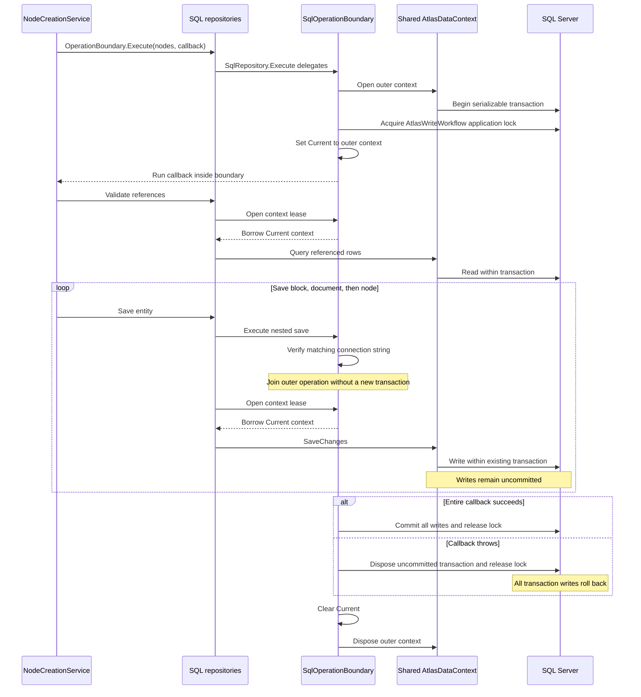

# PTT-130: one operation, one transaction

Creating a node writes a Content block, a Content document, and a Graph node. These are separate repository calls, but the outer operation owns their commit. The repositories share an EF context through `SqlOperationBoundary`, not through the domain objects.

## Follow the code

| Step | Code |
|---|---|
| Wrap the complete node-creation callback | [NodeCreationService](../../src/Atlas.Console/NodeCreationService.cs) |
| Detect the repository's boundary capability | [OperationBoundary.Execute and IOperationBoundary](../../src/Atlas.Contracts/Operations/OperationBoundary.cs) |
| Implement the interface and delegate execution | [SqlRepository.Execute](../../src/Atlas.Console/Storage/SqlRepository.cs) |
| Own or join the transaction, expose the current context | [SqlOperationBoundary.Execute and Open](../../src/Atlas.Console/Storage/SqlOperationBoundary.cs) |
| Save Content rows through inherited helpers | [SqlDocumentRepository](../../src/Atlas.Console/Storage/SqlDocumentRepository.cs) |
| Save Graph rows through inherited helpers | [SqlNodeRepository](../../src/Atlas.Console/Storage/SqlNodeRepository.cs) |

`Current` is an `AsyncLocal` execution-scope value. It is not a context shared globally across requests. A nested call opens a temporary candidate only to verify its connection string, then disposes it and borrows `Current`. A borrowed context lease does not dispose the outer context.

`SaveChanges` flushes pending changes to SQL. Since an explicit outer transaction is active, those writes are still subject to rollback. Only the outer boundary commits. A repository save without an existing boundary instead creates its own boundary for that save; it cannot retroactively group earlier independent saves.

The named application lock makes cooperating writes take turns before reference and ancestry checks. It is separate from transaction atomicity and normal SQL row/range locks. It is released on commit or rollback, waits up to 15 seconds, and does not coordinate code that skips the named lock.

The shared context is not safe for parallel repository work. Different connection strings cannot join the same operation. SQL rollback does not rewind mutated domain objects in memory or roll back external event delivery.

See [the implementation explanation and failure-injection evidence](../security/validation/IMPLEMENTATION.md#complete-operations--ptt-130).
