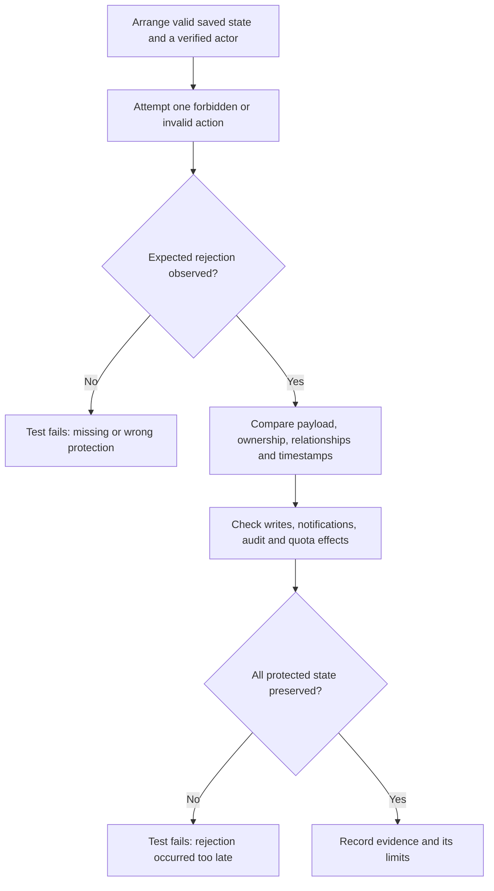

# Negative paths: pre-API security review

[Security index](../README.md) · [Abuse responsibilities](../abuse-prevention/README.md) · [Validation inventory](../validation/DOMAIN-REVIEW.md)

PTT-123 and PTT-124 form one review slice against the backend after PTT-131. A negative path is an operation Atlas should refuse, or a dependency failure it must handle without claiming success. This is a scoped application-readiness review; HTTP/browser security remains PTT-125 and no public API is deployed by this work.

## How to read a negative-path test

A useful test describes **precondition → attempted operation → expected rejection → protected state**. An exception assertion alone does not prove that nothing changed.

For example, a non-author attempting to edit a description should receive an authorization rejection, while the original text, block ordering, timestamps and stored rows remain intact. No success notification should be requested. Denial diagnostics may be emitted: “no unintended side effects” does not mean “no telemetry.”



When the save succeeds and a later subscriber fails, committed state intentionally remains. That is a different failure path from validation before saving. See [transaction/event diagrams](../../architecture/diagrams/TRANSACTIONS-AND-EVENTS.md).

## Reviewed MVP domains and reused evidence

Each row records a reviewed operation family, not exhaustive coverage of every possible input. Existing tests are reused; new tests target side-effect assertions at the extracted workflow seams.

| Area / negative path | Evidence and protected expectation |
|---|---|
| Graph: wrong author, unavailable references, cycles, regressing timestamps | [NodeAuthorizationTests](../../../tests/Atlas.Graph.Tests/NodeAuthorizationTests.cs), [ValidationBoundaryTests](../../../tests/Atlas.Graph.Tests/ValidationBoundaryTests.cs), [SQL operation validation](../../../tests/Atlas.Persistence.Tests/SqlOperationValidationTests.cs). Domain rules and SQL topology coordination reject bad structure. |
| Application node mutations: active participant is not the author | [WorkflowTests.RejectedNodeMutationLeavesStateAndEventsUnchanged](../../../tests/Atlas.Application.Tests/WorkflowTests.cs). Rename/archive/restore/attach/detach preserve state, parent IDs and events; no publication. |
| Content: non-author edit, wrong block/document, invalid payload/index | [WorkflowTests](../../../tests/Atlas.Application.Tests/WorkflowTests.cs), [ContentValidationTests](../../../tests/Atlas.Console.Tests/ContentValidationTests.cs), [SQL application tests](../../../tests/Atlas.Persistence.Tests/SqlApplicationWorkflowTests.cs). All four description entry points are checked for unchanged composition/payload/time after denial. |
| Participants: cross-profile update, missing profile, invalid values | [UpdateParticipantProfileTests](../../../tests/Atlas.Participants.Tests/UpdateParticipantProfileTests.cs), [ValidationBoundaryTests](../../../tests/Atlas.Participants.Tests/ValidationBoundaryTests.cs). Wrong actor does not save. |
| Identity: weak password, duplicate email, unconfirmed/inactive user, lockout, privilege escalation | [SqlIdentityTests](../../../tests/Atlas.Identity.Tests/SqlIdentityTests.cs). Account/profile transaction rollback, persisted role policy and credential/token invalidation. SQL required. |
| Voting: invalid value, ineligible participant, unavailable target, other participant's undo | [VotingTests](../../../tests/Atlas.Voting.Tests/VotingTests.cs), [ValidationBoundaryTests](../../../tests/Atlas.Voting.Tests/ValidationBoundaryTests.cs). One current vote is not permission to vote for another actor. |
| Reactions: unknown/suppressed/archived target and invalid vote after applying association | [ReusableReactionTests](../../../tests/Atlas.Graph.Tests/ReusableReactionTests.cs), [SqlThinHostWorkflowTests.ReactionAndVoteShareRollbackBoundaryWithoutConsole](../../../tests/Atlas.Persistence.Tests/SqlThinHostWorkflowTests.cs). SQL proves invalid vote leaves neither new association nor vote. |
| Communities: non-owner mutation, duplicate name, owner leaving | [CommunityTests](../../../tests/Atlas.Communities.Tests/CommunityTests.cs), [SqlThinHostWorkflowTests](../../../tests/Atlas.Persistence.Tests/SqlThinHostWorkflowTests.cs). Rejected owner-only edit retains saved description. |
| Comments: outsider edit/remove, missing parent, unavailable target | [CommentTests](../../../tests/Atlas.Comments.Tests/CommentTests.cs). New tests inspect unchanged body/status/time and save count, and no thread growth after rejected creation/reply. |
| Discovery: invalid paging/non-finite or reversed bounds; hidden-node visibility | [DiscoveryReadQueryTests](../../../tests/Atlas.Discovery.Tests/DiscoveryReadQueryTests.cs), [DiscoveryEdgeCaseTests](../../../tests/Atlas.Persistence.Tests/DiscoveryEdgeCaseTests.cs). Invalid requests stop before the storage port; SQL tests cover visibility. |
| Moderation: unprivileged queue/history/decision, invalid lifecycle | [SecurityAuthorizationTests](../../../tests/Atlas.Moderation.Tests/SecurityAuthorizationTests.cs), [ValidationTests](../../../tests/Atlas.Moderation.Tests/ValidationTests.cs). Submitted cases remain undecided after denial. |
| Notifications: cross-recipient access, duplicate occurrence, delivery outage | [NotificationDomainTests](../../../tests/Atlas.Notifications.Tests/NotificationDomainTests.cs). Recipient ownership and deduplication are distinct from delivery guarantees. |
| Persistence/audit: constraint failure and rollback, cross-database operation | [SqlOperationValidationTests](../../../tests/Atlas.Persistence.Tests/SqlOperationValidationTests.cs), [SqlAuditTests](../../../tests/Atlas.Persistence.Tests/SqlAuditTests.cs). Transactions protect committed rows; failure does not rewind caller-held objects. |
| Cross-domain rejected comments/moderation | New [SqlThinHostWorkflowTests.RejectedCommentsAndModerationLeaveSqlStateAndNotificationsUnchanged](../../../tests/Atlas.Persistence.Tests/SqlThinHostWorkflowTests.cs) reloads SQL rows and checks no notification requests or additional committed audit/outbox rows. |
| Node quota: last slot, expiry, competing writers, rollback, trusted scope cleanup | [NodeCreationQuotaTests](../../../tests/Atlas.Graph.Tests/NodeCreationQuotaTests.cs), [SqlNodeCreationQuotaTests](../../../tests/Atlas.Persistence.Tests/SqlNodeCreationQuotaTests.cs). Reuse these tests instead of introducing a separate limiter. |
| Telemetry privacy and denial classification | [ObservabilityTests](../../../tests/Atlas.Console.Tests/ObservabilityTests.cs); new [NodeCreationQuotaTests.ExhaustionIsReportedOnceAsDeniedWithQuotaReason](../../../tests/Atlas.Graph.Tests/NodeCreationQuotaTests.cs). Quota exhaustion is a correlated Denied/QuotaExceeded signal, not a storage outage. |

## New evidence versus existing evidence

This slice adds nine parameterized node/description denial cases, two comment service tests and one SQL cross-domain rejection test. It also adds a quota telemetry regression and the small classification fix it requires. The MVP extension adds Content URL policy tests and deep/malformed thread-read tests, with URL validation and iterative traversal implementations. The SQL test checks committed success-audit absence, not that denial diagnostics are suppressed. The URL/thread changes require no schema change. The voting, community and report quota extensions below add ledger tables and require developer-generated migrations.

## Limits and remaining work

- In-memory tests show method ordering, unchanged caller state and emitted messages; SQL integration tests establish committed database behavior. A skipped SQL test is not a passing verification.
- The test helpers accept actor IDs to exercise policy. A future API must prove identity server-side and must not accept the actor, roles or trusted-import flag from request content.
- Named tests establish selected scenarios, not complete security proof. Permission combinations, race conditions and new routes need continuing review.
- Comment traversal now uses an explicit stack and rejects malformed structure. Deep valid threads are supported; interactive comment reads now use capped root/reply pages and cancellation ([PTT-138](https://thepublicthinktank.atlassian.net/browse/PTT-138)); full-thread utility callers and broader API reads still need workload-aware review. Current value-size limits and output paging alone do not bound all backend work.
- API request/connection limits, cancellation/timeouts, forwarded-IP trust, account/IP throttling, 429 mapping and browser controls remain explicit API work. See [abuse responsibilities](../abuse-prevention/README.md#api-acceptance-requirements).
- Quota-ledger retention and account-deletion policy remain open ([PTT-139](https://thepublicthinktank.atlassian.net/browse/PTT-139)). Historical evidence should not silently become permanent retention.

## Run the evidence

From the solution root:

```powershell
dotnet test tests/Atlas.Application.Tests/Atlas.Application.Tests.csproj
dotnet test tests/Atlas.Comments.Tests/Atlas.Comments.Tests.csproj
dotnet test tests/Atlas.Graph.Tests/Atlas.Graph.Tests.csproj
dotnet test tests/Atlas.Console.Tests/Atlas.Console.Tests.csproj
dotnet test tests/Atlas.Persistence.Tests/Atlas.Persistence.Tests.csproj
```

SQL tests require `ATLAS_SQL_TEST_CONNECTION_STRING` through the existing shared user secrets or environment. CI runs the SQL suites against SQL Server. Continue to run other affected domain suites as their behavior changes; the inventory links their existing coverage.

## MVP extension: safe URL forms and deep discussions

[ContentUrlPolicyTests](../../../tests/Atlas.Application.Tests/ContentUrlPolicyTests.cs) exercises rejected schemes, credentials, raw controls, ambiguous backslashes, relative media compatibility, oversized URLs and reconstitution. Rejected edits preserve original fields and timestamps. This does not classify destinations as trustworthy or sanitize links embedded in Markdown.

[CommentTests](../../../tests/Atlas.Comments.Tests/CommentTests.cs) includes a 20,000-comment valid thread read plus orphan/cycle rejection. Existing branching/order tests remain in force. These tests protect reliable reading, not an anti-discussion depth limit. See [MVP protections and limits](../abuse-prevention/README.md#mvp-protections-implemented-in-this-pr).

## Voting action quota extension

[VoteActionQuotaTests](../../../tests/Atlas.Voting.Tests/VoteActionQuotaTests.cs) and [SqlVoteActionQuotaTests](../../../tests/Atlas.Persistence.Tests/SqlVoteActionQuotaTests.cs) cover shared cast/change/undo accounting, no refunds, exact expiry, participant isolation, invalid/no-op behavior, rollback and concurrent last-slot attempts. [Migration commands and rationale](../abuse-prevention/VOTING-ACTION-QUOTA.md) distinguish fresh-model SQL testing from the pending developer-generated upgrade migration.

## Community creation quota extension

[CommunityCreationQuotaTests](../../../tests/Atlas.Communities.Tests/CommunityCreationQuotaTests.cs)
checks one creation per rolling 24 hours and the exact retry message.
[SqlCommunityCreationQuotaTests](../../../tests/Atlas.Persistence.Tests/SqlCommunityCreationQuotaTests.cs)
checks persistence across repositories, separate participant budgets, no refund on archive,
allowed edits, exact expiry, rollback without community/membership/ledger residue, direct
repository enforcement, backdating rejection and competing last-slot attempts.
See [policy and migration handoff](../abuse-prevention/README.md#community-creation-budget).

## Report submission quota extension

[ReportSubmissionQuotaTests](../../../tests/Atlas.Moderation.Tests/ReportSubmissionQuotaTests.cs)
checks the three-per-hour policy, fourth-report rejection, exact cutoff and support
message. [SqlReportSubmissionQuotaTests](../../../tests/Atlas.Persistence.Tests/SqlReportSubmissionQuotaTests.cs)
checks persisted budgets, unchanged queue/audit/outbox on rejection, independent reporters,
unblocked moderator decisions, invalid/rolled-back submissions and concurrent last-slot
attempts. See [policy and migration handoff](../abuse-prevention/README.md#report-submission-budget).

## PTT-138: bounded comment loading

Root/reply pages reject out-of-range sizes and cross-target parents. Cancellation
propagates to EF; Console navigation reads only selected branches. The legacy deep
traversal/corruption tests remain, but hosts no longer materialize full threads.
See [workflow, query evidence and migration guide](../../workflows/COMMENTS.md).
