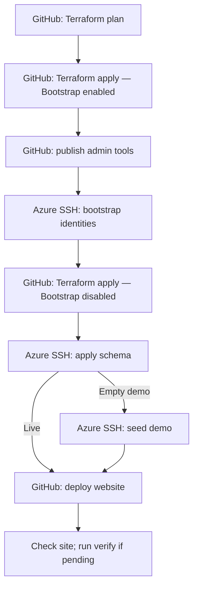

# Azure deployment overview

Terraform runs through GitHub Actions, so plans, approvals and results are recorded
with each run. Database commands run through Azure App Service SSH.

**Ready to deploy?** Follow [First deployment](FIRST-DEPLOYMENT.md).
For a new repository or Azure account, complete [Azure setup](AZURE-SETUP.md) first.

## How the pieces fit

The website package contains both the static Svelte frontend and the ASP.NET Core
API. The operations app is a separate host for database administration.

## Choose the target

These controls separate **which code runs** from **which Azure installation changes**.

| Control | What to select |
| --- | --- |
| Branch | Code and workflow version. Targeting main requires branch `main`; rehearsals may use a trusted branch. |
| Installation | `main` for the existing installation; `rehearsal` for a separate test installation. |
| Rehearsal name | A unique suffix, such as `trial02`. Keep it the same throughout that rehearsal. |
| Applications to provision | `default` means both for main, live only for rehearsal. Explicit choices: `live`, `demo`, `both`. |
| Variant | In admin and website Actions, choose one of the variants already provisioned. |

A new rehearsal name selects separate resources and a separate state blob.
Reusing the name selects the same installation.

Leaving the name blank uses the tracked example; it does not generate a unique
name. Prefixes and state keys come from [deployment-targets.json](config/deployment-targets.json).
See [Azure setup](AZURE-SETUP.md#6-review-the-public-target-profiles) for naming rules.

## Which Action does what?

Open **GitHub → Actions → the workflow → Run workflow**.

| Action | Purpose |
| --- | --- |
| [Terraform plan](../.github/workflows/AtlasAzurePlan.yml) | Preview infrastructure changes without applying them. |
| [Terraform apply](../.github/workflows/AtlasAzureApply.yml) | Create a plan, pause for approval, then apply that saved plan. |
| [Admin tools](../.github/workflows/AtlasAdmin.yml) | `publish` uploads the database tools. The optional `bootstrap` operation also triggers identity setup. |
| [Manual Azure deployment](../.github/workflows/AtlasDeploy.yml) | `deploy` publishes the website; `verify` checks it without redeploying. |
| [Rehearsal cleanup](../.github/workflows/AtlasAzureCleanup.yml) | `plan` previews deletion; `delete` requires confirmation and approval. |
| [Terraform validation](../.github/workflows/AtlasInfrastructure.yml) | Checks configuration and scripts without deploying to Azure. |

The shared GitHub Environment is `atlas-infra-apply`. Its credentials manage all
installations; no separate GitHub Environment is needed per rehearsal or variant.

## After the first deployment

- **Application release:** use the website deployment Action.
- **Schema change:** publish updated admin tools and apply schema before the release.
- **Check an existing site:** use website operation `verify`.
- **Remove a rehearsal:** follow [Rehearsal cleanup](REHEARSAL-CLEANUP.md).

Normal provisioning stops deletions, replacements and removal of existing variants.
The [security guide](SECURITY.md) explains these guards.

## Costs and verification

B1 hosting and the SQL private endpoint are billable. Private DNS, state storage,
data transfer and monitoring can also incur charges. SQL free allowances have limits;
the configuration pauses at the free limit rather than enabling paid overage.

Each rehearsal creates another installation with its own costs. Check current
subscription eligibility and regional pricing before provisioning.

For resource counts, see [Resource inventory](PROVISIONED-RESOURCES.md).
For monitoring checks, see [Telemetry](TELEMETRY.md).
