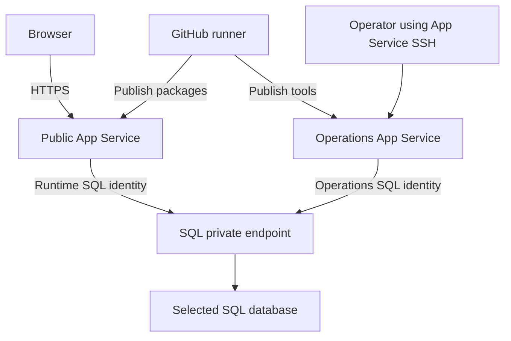

# Why database administration uses App Service SSH

Atlas websites are public over HTTPS. Azure SQL has public networking disabled,
so database commands need a private network path.

For the commands and deployment order, use [First deployment](FIRST-DEPLOYMENT.md).
This page explains the network and identity boundaries.

## Where connections run

The two apps use outbound VNet integration to reach the private endpoint.
GitHub publishes packages through Azure’s management/deployment services; it does
not connect directly to private SQL.

A normal laptop or GitHub-hosted runner has no direct route to this database.
Do not open SQL publicly to run migrations.

## Two hosts, two responsibilities

| Host | Runs | SQL access after bootstrap |
| --- | --- | --- |
| Public app | Static frontend and API | Runtime reads/writes and required execution permissions |
| Operations app | Explicit Atlas.Admin commands | Schema administration in its matching database |

Each selected variant has its own pair of hosts and user-assigned identities.
The hosts share the installation’s B1 plan and network.

The operations host is not a public administration website. Use authorized SSH
access; do not add an anonymous endpoint for running database commands.

## Private name resolution

Use the server’s normal `*.database.windows.net` hostname in connection strings.

- Private DNS resolves it to the SQL private endpoint inside the VNet.
- The app integration subnet supplies the outbound network path.
- The endpoint subnet’s NSG permits SQL port 1433 from the app subnet.

Private networking supplies reachability. The matching managed identity and SQL
grants supply permission. Both are required.

## SSH, Cloud Shell and WebJobs

- **App Service SSH:** runs commands in the selected operations app. This is the
  documented database-administration route.
- **Azure Cloud Shell:** useful for Azure account and resource management; it is
  not the operations app’s private-network terminal.
- **Kudu/WebJobs:** deployment and job execution services. The optional bootstrap
  WebJob is separate from the SSH session.

The published package includes SSH tools and one bootstrap WebJob. Schema setup
and demo seeding are explicit SSH commands, not app-startup tasks.

## Related guides

- [Security](SECURITY.md): approvals, privileges and deletion guards.
- [Resource inventory](PROVISIONED-RESOURCES.md): counts, shared resources and costs.
- [Atlas.Admin](../src/hosts/Atlas.Admin/README.md): executable and local development.
