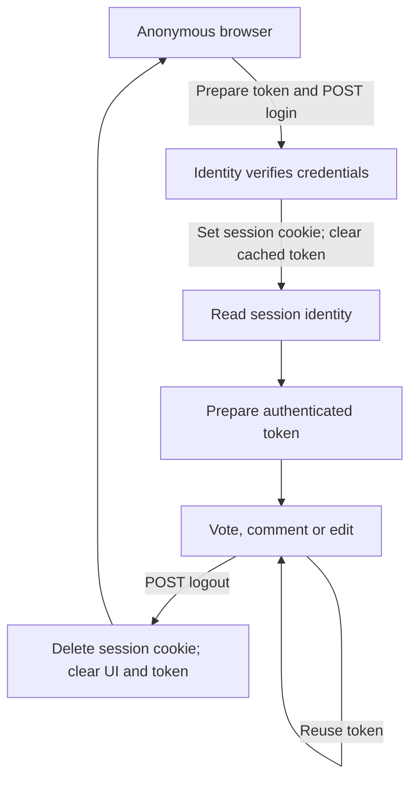

# Browser sessions and CSRF: a frontend workflow tour

[Frontend helpers](../src/lib/api/README.md) · [API authentication](../../../../docs/api/AUTHENTICATION.md)

The session adapter is a small collaboration between the request helper, session
controls and a reactive identity reader. It is not another authentication system.
ASP.NET Core Identity and the API remain responsible for authentication and authorization.

## What lives where?

| Piece | Owner and lifetime | Purpose |
|---|---|---|
| `__Host-Atlas.Session` | Browser cookie jar; Secure, HttpOnly, SameSite=Lax | Carries Identity's encrypted authentication ticket; eight-hour fixed lifetime, nonpersistent login |
| `__Host-Atlas.Csrf` | Browser cookie jar; Secure, HttpOnly, SameSite=Strict | Cookie half of ASP.NET Core's antiforgery pair |
| JSON `token` | Request helper's browser memory, separately per routing prefix | Explicit `X-CSRF-TOKEN` header on unsafe requests |
| Participant ID | Session controls and `editorSession` readable | Shows available UI actions; never substitutes for server authorization |

HttpOnly prevents JavaScript from reading a cookie. It does not prevent the browser
from attaching that cookie to an eligible request. The helper uses
`credentials: 'same-origin'`; the browser handles cookies without copying them into
Redux, localStorage or request JSON. The separate request token is readable JSON.

## Follow a visit

1. **Browse anonymously.** Public node/search reads use `/atlas-public-api`.
   These development reads deliberately strip cookies and cannot establish a session.
2. **Prepare a write.** `apiRequest` asks the session route for `GET auth/csrf` if
   no token is cached. The browser accepts the antiforgery cookie; the helper keeps
   the JSON token in memory. Concurrent callers share the same preparation.
3. **Sign in.** `SessionControl.signIn` sends `POST auth/login` with credentials,
   the header token and browser-managed cookies. Identity responds with a session
   cookie. The helper clears cached tokens immediately after the login attempt,
   including when its response is lost. The control then reads `GET auth/session`
   to confirm the participant and emits `atlas-session-changed`.
4. **Use the app.** Session-aware reads use `/atlas-session-api`. Reads need no CSRF
   header. The first subsequent write lazily obtains a token for the authenticated
   principal; later votes, comments and edits reuse it. API policies and domain rules
   still decide whether each operation is allowed.
5. **Sign out.** `SessionControl.signOut` or the header sends `POST auth/logout`
   with the current pair. Identity deletes this browser's session cookie. The helper
   clears cached tokens; the UI clears identity after success and notifies listeners.
   The next anonymous write/login prepares an anonymous token.

## Clearing a cache is not revoking every issued token

ASP.NET Core validates the cookie/request-token pair and its binding to the current
principal. This implementation does not maintain a database list of issued CSRF
request tokens, consume them after one use, or revoke every previously issued token
when the frontend clears its cache. Fetching a fresh token does not promise that
older tokens become unusable. Logout clears the authentication cookie; it does not
promise to delete the separate antiforgery cookie or revoke copied authentication
tickets on every device. See the API authentication guide for these distinctions.

Token reuse avoids unnecessary preparation requests, not a supposed cost of revoking
a growing token list. One-use tokens would require a different server protocol and
concurrency/replay design; this pass retains the framework's reusable-token flow.

The helper clears tokens after login/logout/account-closure attempts, on this tab's
`atlas-session-changed` notification, and when the window regains focus (another tab
may have changed the shared cookies). A generation check rejects a write whose token
preparation crossed a known session change. A full reload starts with an empty cache.
Tokens are not shared between server requests if SSR is enabled later.

## Failures and recovery

- **400:** may be validation or antiforgery rejection. Discard the token conservatively.
- **401:** session absent/expired or sign-in rejected. Discard the token; callers show
  their sign-in state or message.
- **403:** permission denial; discarding the token does not grant permission.
- **429:** display throttling guidance; do not automatically resubmit.
- **Transport failure:** the outcome of a write may be unknown. Never replay it blindly.
  An uncertain identity-changing request still clears tokens.

There is no automatic retry loop. After a rejection, a later explicit action may
prepare a new token. Another tab can change identity while this tab stays focused;
server validation remains authoritative and can reject the stale pair. Already-sent
requests cannot be undone by clearing frontend memory. Cancellation stops one caller
without cancelling a preparation needed by another; shared preparation has a ten-second timeout.

## Development routing versus deployment

[`dev/localApi.ts`](../dev/localApi.ts) configures Vite and Storybook:

| Browser prefix | Forwarded path | Cookie behavior |
|---|---|---|
| `/atlas-public-api` | `/api` on the local API | Strips cookies/authorization and returned Set-Cookie; allowlisted GET only |
| `/atlas-session-api` | `/api` on the local API | Forwards only Atlas session/CSRF cookies, preserves their security attributes; allowlisted methods and same-origin write checks |

Run `npm run dev:api` from Atlas.Web after database setup and seeding, using the
trusted ASP.NET development certificate. Default API target is `https://localhost:7240`.
Use one consistent browser hostname; localhost and 127.0.0.1 have different cookie
jars. Secure cookies need a browser-supported secure context; verify actual cookie
acceptance in DevTools rather than assuming that proxying to HTTPS makes an HTTP
frontend HTTPS. The development proxy accepts the local API certificate and never
removes Secure/HttpOnly flags. Use local HTTPS if your browser rejects loopback cookies.

These proxy guards are development infrastructure, not production hosting. A static
build does not include them. Production must explicitly route the frontend's prefixes
to the API (or configure the callers to use same-origin `/api`) over HTTPS. Do not
broaden CORS or weaken cookie/CSRF rules to compensate for missing routing.

## Source reading order and verification

1. [`SessionControl.svelte`](../src/lib/components/SessionControl.svelte): login, session read and logout UI.
2. [`apiRequest.ts`](../src/lib/api/apiRequest.ts): token cache, headers, credentials and safe HTTP errors.
3. [`editorSession.ts`](../src/lib/api/editorSession.ts): shared identity read, subscription cleanup and change notifications.
4. [`AccountsController.cs`](../../Atlas.Api/Controllers/AccountsController.cs): framework token issuance and Identity endpoints.
5. [`dev/localApi.ts`](../dev/localApi.ts): development forwarding boundaries.

`tests/csrf-adapter.spec.ts` uses deterministic mocked transport to check reuse,
concurrency, identity transitions, cancellation, stale preparations and no write replay.
These tests do not prove browser cookie acceptance or framework validation. Before
closing PTT-147, exercise a real API/browser session: anonymous CSRF → login → session
read → two protected writes sharing one preparation → logout → anonymous session denial.
Also check missing/mismatched CSRF rejection and repeat after session expiry. Inspect
request headers and cookie flags without saving tokens/passwords in screenshots or logs.
